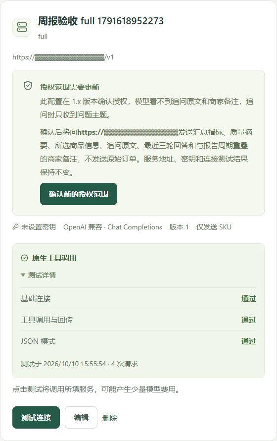
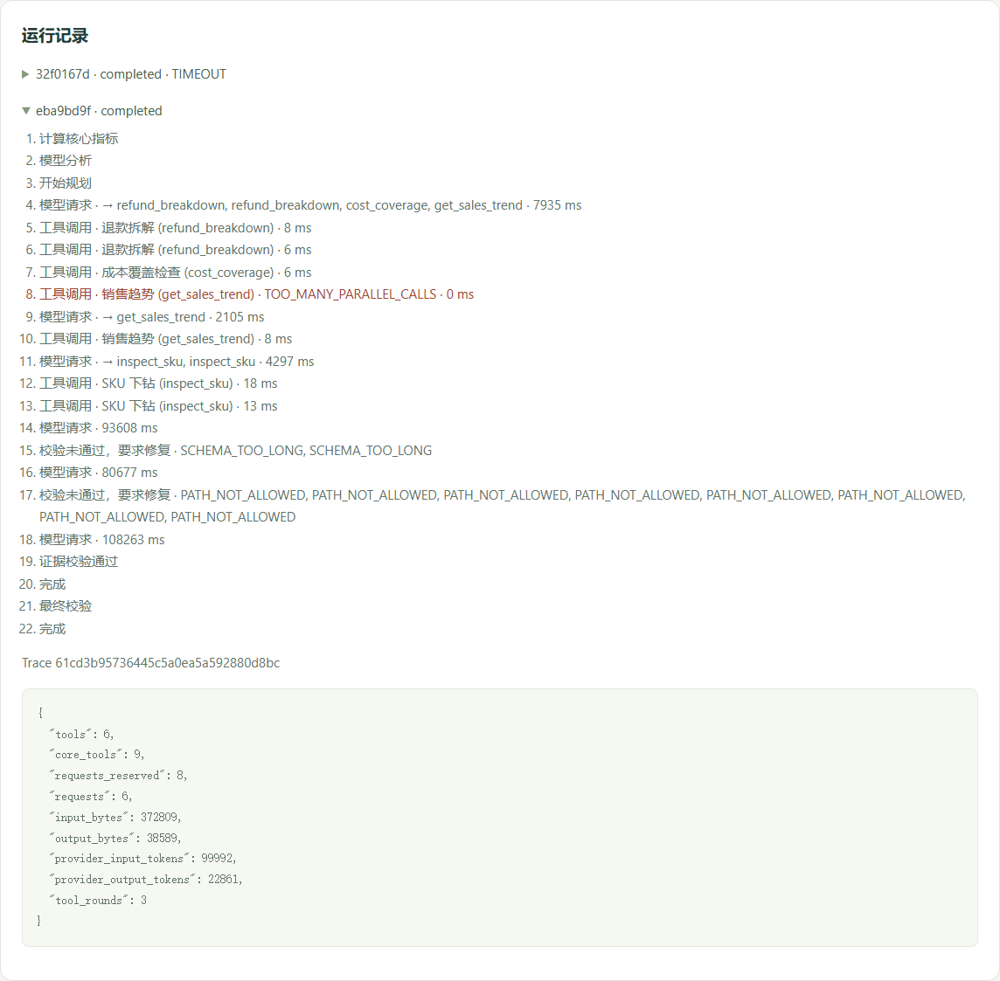
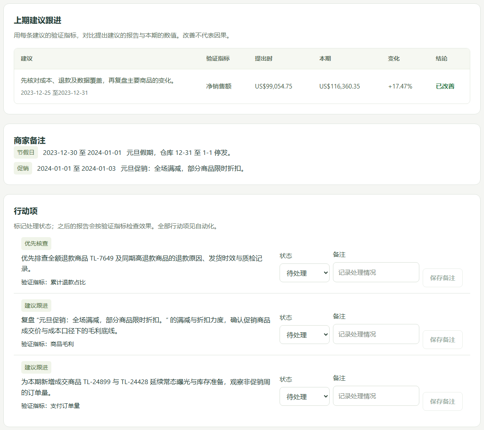
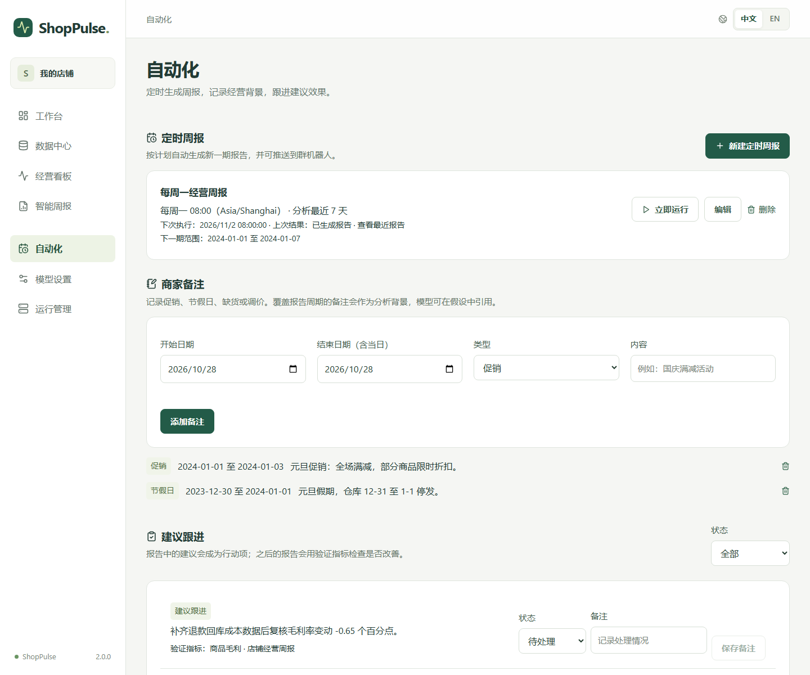

# ShopPulse

ShopPulse 是一款开源的电商经营分析应用，将 Excel / CSV 订单与商品成本表转化为可视化看板和智能周报。上传数据后，可确认字段映射、检查缺失与异常，按时间查看销售额、订单量、客单价、毛利及商品表现，并通过周期对比定位经营变化。**数字由代码计算，模型负责分析与解释**：Agent 在计算结果上逐步下钻，生成异常说明与经营建议，报告中的每个数字、商品和日期都绑定到计算证据，支持查看依据、继续追问，以及导出 HTML、Markdown ZIP 和 PDF。应用本地部署，支持中英文界面与中英文报告，可接入 OpenAI Chat Completions、OpenAI Responses 或 Anthropic Messages 接口的模型服务，并能定时生成周报、推送到群机器人、跟进建议效果，让商家从整理表格到复盘经营，在一个界面内完成。

当前版本 `2.0.0` · 桌面 Web（至少 1024px）· 单店铺本地部署 · 中英文界面

[安装](#安装) · [使用](#使用) · [运行示例](#运行示例) · [版本记录](#版本记录) · [技术文档](docs/TECHNICAL.md)


## 功能

- **导入与校验**：字段映射、缺失与异常检查、成本关联、数据版本冻结。
- **经营看板**：销售、订单、客单价、毛利、商品排名、周期对比和销售变化贡献。
- **智能周报**：图表、确定性异常规则、经营观察与行动建议；模型可下钻到商品、日期、退款和成本，观察与建议可点名具体商品，所有取值由证据渲染。
- **追问与证据**：围绕报告对话式追问，模型可反问或建议新的分析范围；每句话都能追溯到数据版本、时间范围和计算结果。
- **自动化**：定时生成周报并推送到群机器人（通用 Webhook、Slack、飞书、企业微信、钉钉）；记录促销、节假日等商家备注；建议成为行动项，后续报告自动复查效果。
- **导出与模型**：HTML / Markdown ZIP / PDF，中英文输出；配置三种接口协议的模型并测试连接。
- **运行管理**：任务状态、Worker、运行轨迹、数据保留与清理。

不配置模型也可使用导入、看板、确定性周报和定时任务；模型失败时保留计算结果。

## 安装

需要 **Python 3.12** 和 **Docker Desktop（Linux containers）或 Docker Engine + Compose v2**。

在项目根目录执行：

```powershell
# Windows PowerShell
if (-not (Test-Path .env)) { Copy-Item .env.example .env }
python scripts/init_secrets.py
docker compose up -d --build
```

Linux / macOS：

```bash
test -f .env || cp .env.example .env
python3 scripts/init_secrets.py
docker compose up -d --build
```

打开 [http://localhost:8080](http://localhost:8080)。日常启动用 `docker compose up -d`，停止用 `docker compose down`。数据位于 Docker 卷，密钥位于 `secrets/`，请保留；停止时不要加 `--volumes`。

从 1.x 升级：先用 `python scripts/backup.py backup --directory backups/<名称>` 备份，再执行 `docker compose up -d --build`，数据库迁移自动完成；已保存的模型配置会在模型设置页提示确认新的授权范围（见下文）。

不用 Docker 可按[原生安装步骤](docs/TECHNICAL.md#无-docker-运行)运行。目前没有 Windows 一键安装包。

## 使用

1. **导入成本**：数据中心上传成本表，确认字段、币种和生效时间，校验后发布。
2. **导入订单**：关联成本版本，确认支付、退款、时区和覆盖范围，处理校验问题后发布。
3. **查看看板**：选择数据版本、日期及比较周期，查看指标、趋势和商品表现。
4. **生成周报**：选择模型或确定性摘要、报告语言；查看证据与运行轨迹，追问，导出。更换分析范围时创建新修订。
5. **自动化**：记录促销等商家备注；把建议标记为已完成或忽略；建立定时周报并配置群机器人推送。

模型设置中选择接口协议，填写 API 根地址（如 `https://provider.example/v1` 或 `https://api.anthropic.com/v1`）、模型 ID 和 API Key，保存后测试连接。Key 仅在后端加密保存，不回显、不写入日志；真实模型调用可能产生费用。带推理（thinking）的模型生成最终报告较慢，请把请求超时调到 120 秒以上（最多 300 秒），并优先选择速度较快的型号。

## 运行示例

演示使用 [Google TheLook 合成电商数据](https://console.cloud.google.com/marketplace/product/bigquery-public-data/thelook-ecommerce)：9,812 笔订单、14,208 条明细。文件：[成本](samples/thelook/costs.csv)、[订单](samples/thelook/orders.csv)。详细导入设置和转换口径见[复现步骤](docs/TECHNICAL.md#示例数据与复现)。

2024-01-01 至 01-07：净销售额 **USD 116,360.35**，支付订单 **1,607**，估算毛利 **USD 48,910.09**。演示以创建时间代替支付时间、退货按全额退款、回库数量未知；这些是转换假设，不能视为真实支付流水。

以下均为 2.0.0 本地应用的实际页面，2026-10-28 拍摄；模型相关页面使用真实服务配置 `qwen3.8-flash`（OpenAI 兼容接口，请求超时 300 秒），模型名称为所配置服务的 ID。

### 导入表格，确认字段与数据质量

数据中心分别管理成本和订单的版本，发布后的版本供看板和报告使用。


上传后自动建议字段映射，可调整订单编号、SKU、实付、退款等字段，并确认币种、金额层级、支付与退款口径和覆盖范围。


校验列出问题所在行和处理建议，确认后再发布数据版本。本例纳入全部 14,208 条明细，0 条阻断；2,245 条警告提示回库数量未知。截图为同一文件的检查草稿，正式分析使用已发布版本。


### 查看趋势与商品表现

看板汇总销售、订单、客单价与毛利；下方展示每日趋势和销售变化贡献。可按日期、SKU 筛选，并与上一周期或指定周期比较。


商品表可按指标排序，查看销量、退款、毛利和销售变化，帮助定位值得进一步核查的商品。


### 连接自己的模型

模型设置支持 OpenAI Chat Completions、OpenAI Responses 和 Anthropic Messages 三种协议，填写服务地址、模型名称和 Key 即可。从 1.x 升级后，已保存的配置会提示授权范围需要更新：确认后新建的报告才会把追问原文和商家备注发送给模型，服务地址、密钥和测试结果不变。截图中的地址已遮挡。



连接测试展示基础响应、工具调用、JSON 模式和 JSON Schema 结构化输出四项能力，方便判断服务是否兼容。


### 生成有依据的经营周报

报告保存本次数据版本、分析周期和计算结果，集中展示经营概览、图表与异常检查。更新数据或调整周期时创建新修订，原报告保持不变。


模型在七个核心计算结果之上自行下钻：查看退款最高的商品、单个 SKU 的两期表现、缺少成本的商品。每一步都记录在报告的运行记录里，生成过程中实时更新。



观察可以附带支撑事实并点名具体商品，但金额、比例、SKU、日期和规则名都只能通过指向证据的占位符写入，由服务端取值渲染；可能原因标为“待验证假设”。建议给出验证指标和复查周期，并自动成为可跟进的行动项。


### 查看证据，继续追问

点击“查看证据”，可追溯指标对应的数据版本、时间范围、工具参数和结果哈希。


追问会连同最近几轮问答一起交给模型，模型可以继续调用工具回答；问题不明确时会反问并给出选项，超出报告范围时会给出建议的日期范围并生成预填好的新建分析。本例追问本周退款原因。


### 跟进建议，记录经营背景

上一期报告的建议会在本期按验证指标复查，结论为已改善、未改善或数据不足；商家备注（促销、节假日、缺货、调价）作为分析背景进入报告，模型可在假设中引用。



### 定时周报与推送

自动化页管理定时周报、商家备注和行动项。定时任务在新数据到达后生成下一期报告，可推送到群机器人；“立即运行”会强制生成。



### 导出报告

同一份报告支持三种格式：HTML 可离线浏览，Markdown ZIP 包含正文、图表与证据 JSON，PDF 用于分享和打印。导出的章节标题和标签随报告语言。本例三种导出均已生成并核对文件哈希。


### 中英文切换与运行管理

右上角可切换中文或英文，保留当前筛选和未提交表单；商品名称、用户输入及已保存报告保持原文。报告语言在创建时单独选择。


运行管理可查看队列、Worker、存储状态和保留策略。清理前会预览影响范围，确认后执行；截图展示整个本地实例的状态。


## 版本记录

### 2.0.0 · 2026-10-28

围绕“模型如何在可核验的前提下给出更具体的分析”重做了 Agent，并补上了让周报真正进入日常经营节奏的功能：

- **模型会自己下钻，但写不出任何未经计算的数字。** 1.x 只允许模型原样复制服务端给出的整句事实，因此观察和建议无法具体到商品或日期。现在模型自己组织句子，句中的金额、比例、SKU、日期、规则名和商家备注都写成指向证据字段的占位符，服务端按白名单路径取值并渲染。在七个核心计算工具之外，新增单个 SKU 下钻、退款拆解、成本覆盖检查和指标口径说明，核心工具也支持子区间与指标子集。模型最多分五轮、每轮三个并行调用，重复调用被拒绝，没有新证据时自动收尾；输出不合规时服务端把问题位置发回模型定向修复，最多两次，失败则保留确定性结果。模型循环运行在只持有 Key 的子进程中，所有工具请求经管道回到 Worker 执行，父进程再用自己的证据复核一次。
- **追问变成对话。** 经授权后追问原文和最近三轮问答交给模型，模型可以继续调工具回答；问题不明确时反问并给出选项，超出报告范围时给出建议的日期与 SKU 范围并生成预填好的新建分析。授权范围升级为 2.0，旧配置在模型页一键确认，已有报告沿用创建时冻结的授权。
- **周报进入经营节奏。** 每条建议成为行动项，可标记完成或忽略并写备注；后续报告按验证指标复查上期建议是否改善。商家可记录促销、节假日、缺货、调价等备注作为分析背景。定时任务在新数据到达后自动生成下一期并推送到通用 Webhook、Slack、飞书、企业微信或钉钉机器人；新增“自动化”页集中管理。
- **接入范围更广。** 支持 OpenAI Chat Completions、OpenAI Responses 和 Anthropic Messages 三种协议，优先使用 JSON Schema 结构化输出；报告和导出可选中文或英文；提示词按版本目录存放。
- **可观察、可评测。** 报告页实时推送运行轨迹并显示 trace ID；可选接入 OpenTelemetry（OTLP/HTTP），调试留存默认关闭并自动清理。仓库自带十个合成数据评测用例，CI 在证据通过率、商品点名率、规则提及率等指标退步时失败；真实模型可用在线套件和评审模型打分，并与人工标注校准。

数据库新增一个迁移（行动项、商家备注、定时任务三张表及若干列），升级前请备份。新增配置项 `DRILL_ROW_LIMIT`、`AGENT_DEBUG_CAPTURE`、`AGENT_DEBUG_RETENTION_DAYS`、`SCHEDULER_ENABLED`、`OTEL_EXPORTER_OTLP_ENDPOINT`；通知地址与模型服务共用 `MODEL_ALLOWED_ORIGINS` 白名单。

### 1.0.0 · 2026-10-11

首个版本：Excel / CSV 导入与字段映射、质量校验与数据版本冻结、经营看板与周期对比、确定性异常规则、基于证据的智能周报与追问、三种格式导出、OpenAI 兼容模型接入与连接测试、中英文界面、Docker Compose 部署与运行管理。

## 注意事项

- 毛利未扣广告、佣金、运费、人工和税费；累计退款归原支付周期。
- 缺成本、未知退款或覆盖不足可能使指标不可用；未知回库时毛利标为估算。
- 模型的观察基于计算证据，原因只是待验证假设；建议不会自动执行。
- 默认服务仅本机访问，无内建账号权限；远程部署需自行控制访问范围。
- 排队、模型降级、备份恢复及部署配置见[技术文档](docs/TECHNICAL.md#运维与排障)。

## 开发与许可

React + TypeScript、FastAPI、PostgreSQL、Pandas，可选 OpenTelemetry。[技术文档](docs/TECHNICAL.md)包含技术栈、架构、数据模型、指标口径、Agent 与评测、API、开发和测试步骤。

项目自有代码与文档采用 [MIT License](LICENSE)，版权归 **陈实当 CHEN SHIDANG (UrianChen)** 所有。允许使用、修改和商用，分发时保留版权及许可声明。

第三方组件、字体和外部演示数据遵循各自许可，不包含在本项目的 MIT 授权范围内。第三方声明见 [licenses](licenses/)，字体许可见 [OFL.txt](backend/assets/fonts/OFL.txt)；TheLook 镜像数据的再分发授权尚待核实。
