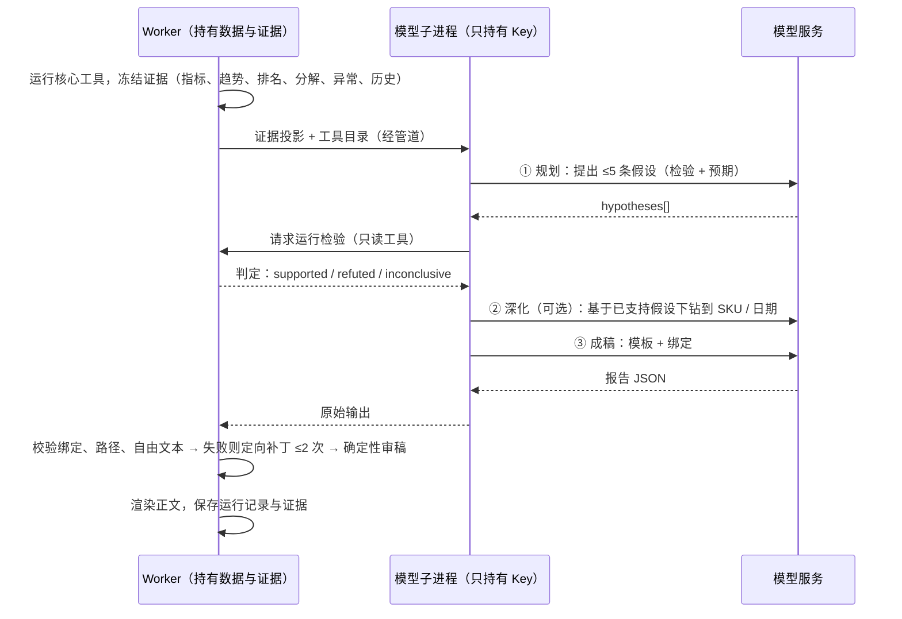

# ShopPulse

简体中文 | [English](README.en.md)

**把 Excel / CSV 订单表变成经营看板和可核验的 AI 周报。** 数字由代码计算，模型负责解释：报告里的每个金额、比例、商品和日期都绑定到一条计算证据，模型提出的每个原因都由服务端跑检验裁决。模型写不出任何未经计算的数字，也不能把没通过检验的原因写进结论。

当前版本 `3.0.0` · 桌面 Web · 单店铺本地部署 · 中英文界面与报告 · MIT

[核心机制](#核心机制) · [快速开始](#快速开始) · [运行示例](#运行示例) · [评测](#评测) · [架构](#架构) · [设计取舍](#设计取舍) · [版本记录](#版本记录) · [技术文档](docs/TECHNICAL.md)


## 核心机制

大多数"AI 经营分析"把计算结果喂给模型，然后信任模型写出的数字和原因。ShopPulse 在两处把控制权拿回来：

**1. 证据绑定：模型写模板，服务端填值。**
模型输出的每句话是一个带 `{{占位符}}` 的模板加一组绑定，每个绑定指向某条证据记录中的一个白名单路径。服务端取值、校验类型并渲染；去掉占位符后的自由文本不得出现任何数字（含中文数字、"翻倍""一半"）、百分号、SKU 或"必然导致"之类的确定性断言。

```json
{"template": "净销售额最高的商品是 {{sku}}，净销售额为 {{sales}}。",
 "bindings": [
   {"name": "sku",   "evidence_id": "ev_…", "path": "items.0.sku", "format": "entity"},
   {"name": "sales", "evidence_id": "ev_…", "path": "items.0.current.metrics.net_sales", "format": "money"}]}
```

**2. 假设由服务端裁决：模型提问，代码回答。**
模型不直接写"退款上升是因为 A 商品"，而是提出一条假设：一个陈述、一次只读工具调用作为检验、一个可机器判定的预期（大于 / 份额不低于 / 排名前 k / 两项同向 …）。服务端运行检验并判定 **数据支持 / 已排除 / 无法判断**；最终报告的发现只能引用数据支持的假设，"已排除的原因"只能列被否定的假设。下一期报告还会用同一检验条件复核上期假设。



所有数值、工具、轮次、字节、token、时间都有预算；模型失败时报告退回确定性结果（规则、分解、服务端候选假设的判定），不会空白。

## 快速开始

需要 **Python 3.12** 和 **Docker Desktop 或 Docker Engine + Compose v2**。

```bash
# Linux / macOS
test -f .env || cp .env.example .env
python3 scripts/init_secrets.py
docker compose up -d --build
```

```powershell
# Windows PowerShell
if (-not (Test-Path .env)) { Copy-Item .env.example .env }
python scripts/init_secrets.py
docker compose up -d --build
```

打开 [http://localhost:8080](http://localhost:8080)。数据在 Docker 卷，密钥在 `secrets/`，停止时不要加 `--volumes`。不用 Docker 可按[原生安装](docs/TECHNICAL.md#无-docker-运行)运行；升级与备份见[运维](docs/TECHNICAL.md#清理备份与升级)。

**五步上手：**

1. **导入成本**：上传成本表，确认字段、币种和生效时间，发布。
2. **导入订单**：关联成本版本，确认支付、退款、时区和覆盖范围，处理校验问题后发布。
3. **看板**：选数据版本、日期和比较周期。
4. **周报**：选模型（或无模型的确定性摘要）和报告语言；查看证据与运行记录，追问，导出 HTML / Markdown ZIP / PDF。
5. **自动化**：记录促销、节假日等商家备注；把建议标记完成或忽略；建定时周报并推送到群机器人。

**接入模型**：模型设置里选协议（OpenAI Chat Completions / OpenAI Responses / Anthropic Messages），填 API 根地址、模型 ID 和 Key，测试连接。Key 加密保存、不回显、不写日志。可另填一个同服务上更便宜的审稿模型。不配置模型也能用导入、看板、确定性周报和定时任务。

想先看效果：仓库自带 [TheLook 合成电商数据](samples/thelook/)（9,812 单、14,208 条明细），导入口径见[复现步骤](docs/TECHNICAL.md#示例数据与复现)。

## 运行示例

以下为本地实例的实际页面，数据为 TheLook 2024-01-01 至 01-07（净销售额 USD 116,360.35，1,607 单）。周报相关页面为 3.0.0，模型 Claude Sonnet 5.5（审稿 Claude Haiku 5.5）。

**模型提出假设，服务端裁决。** 本例中服务端候选的"退款占比上升来自单品退款率"被排除——分解显示主要来自商品结构变化（+0.98 对 +0.12 个百分点）。


**观察只能引用数据支持的假设。** 金额、比例、SKU、日期全部由证据渲染；没检验的原因标为"待验证假设"；建议带验证指标和复查周期，自动成为行动项。


**每个数字可追溯。** 证据抽屉显示数据版本、时间范围、工具参数、结果哈希；假设检验显示判定条件和两个操作数的取值来源。


**过程可见。** 规划、检验、成稿、修复、审稿每一步实时写入运行记录。


**追问是对话。** 模型可继续调工具、引用已判定的假设；问题不明确时反问并给选项，超出范围时给出建议范围并生成预填好的新建分析。


<details>
<summary><b>更多页面</b>：导入与校验、看板、模型连接测试、建议跟进、自动化、导出、英文界面、运行管理</summary>

<br>

上传后自动建议字段映射，并确认币种、金额层级、支付与退款口径和覆盖范围。


校验列出问题行和处理建议。本例 14,208 条明细，0 条阻断，2,245 条"回库数量未知"警告。


看板展示每日趋势、销售变化贡献和商品表现，可按日期、SKU 筛选并与上一周期比较。


连接测试依次探测基础响应、工具调用、JSON 模式、JSON Schema 结构化输出和审稿模型，据此决定能力策略。


上一期建议在本期按验证指标复查；商家备注作为分析背景进入报告。


定时周报在新数据到达后生成下一期并推送到群机器人（通用 Webhook、Slack、飞书、企业微信、钉钉）。


同一份报告导出为离线 HTML、Markdown ZIP（含证据 JSON）和 A4 PDF。


界面随时切换中英文，保留筛选与表单；报告语言在创建时单独选择。


运行管理查看队列、Worker、存储与保留策略；清理前预览影响范围。


</details>

## 评测

评测分两层，因为它们回答的是不同的问题。

**离线门禁（CI，不调模型）**：24 个合成用例，每个用固定种子生成 56 天订单并注入有标注的业务变化（退款激增、负毛利、结构变化、单品成本上涨、连续下滑、小样本波动、干扰备注、商品名与备注中的指令注入、跨期复核……）。脚本化策略驱动真实的工具、假设检验、循环和校验；服务端判定、分解方向、连续期数等**确定性答案一项不中即失败**。它衡量的是流水线，不是模型。

**真实模型基线（`--suite live`）**：同一批用例对真实模型各跑 3 次，测通过率、注入原因的召回、干扰项误用、过度因果表述、修复次数、延迟、token 与缓存命中。首轮基线（2026-11-03，详见 [docs/evals](docs/evals/README.md)）：

| | Claude Sonnet 5.5 | Claude Haiku 5.5 |
| --- | ---: | ---: |
| 通过证据校验 | **93.1%** (±2.4) | 50.9% (±17.7) |
| 首稿无需修复 | 22.2% | 11.3% |
| 注入原因召回 | **79.8%** (±2.1) | 32.3% |
| 下钻到具体 SKU | 98.3% | 91.1% |
| 过度因果表述 | 2.0% | 0% |
| 每份报告请求数 / P50 延迟 | 4.6 / 65 s | 3.9 / 66 s |
| 每份报告成本（估） | $0.20–0.23 | 约为 Sonnet 的 1/15 |

**已知的短板，正在处理：** 首稿通过率只有 22%，剩余失败几乎都是修复预算耗尽（`PATH_NOT_ALLOWED`、`UNBOUND_NUMBER_OR_CLAIM`），说明证据语法对模型的学习成本仍然偏高；Haiku 目前只适合做审稿模型；三个阶段输出格式不同导致提示缓存命中只有 37%。方向一致性检查在 44 条人工标注句子上精度 / 召回均为 81%，因此只作审稿提示、不作硬校验。

```bash
cd backend
uv run python -m app.evals run --gate                                   # 离线门禁
uv run python -m app.evals run --suite live --model-config <id> --repeat 3 --max-tokens 15000000
uv run python -m app.evals compare before.json after.json --out diff.md  # 改提示词前后逐例对比
```

## 架构

React 单页应用 → FastAPI（只做短事务、创建任务）→ PostgreSQL 表做持久队列 → 单个 Worker 在子进程中完成解析、指标、导出和模型调用。没有 Redis / Celery，没有厂商 SDK。

| 层 | 选择 |
| --- | --- |
| 前端 | React 19 + TypeScript，TanStack Query 轮询 + SSE 运行轨迹，自绘 SVG 图表，请求类型由 OpenAPI 生成 |
| 后端 | FastAPI，Pydantic `extra="forbid"`，SQLAlchemy 2 + Alembic |
| 计算 | Pandas 只做分组筛选；金额全程整数最小货币单位 + Decimal，分摊用最大余数法保证守恒 |
| 队列 | `SELECT … FOR UPDATE SKIP LOCKED` 领取，心跳续租，fencing token 拒绝过期进程写入 |
| 模型 | 三协议统一消息格式；JSON Schema 严格输出优先；Anthropic 提示缓存断点；预算：8 工具 / 5 轮 / 8 请求 / 2 修复 / 600 s |
| 隔离 | 模型子进程只持 Key 可联网、不碰库；工具请求经匿名管道回 Worker 执行；父进程用自己的证据二次校验 |
| 出站 | 自实现加固 HTTP 客户端：DNS 校验、固定 IP、拒私网与重定向、拒环境代理；精确来源白名单 |
| 凭证 | AES-256-GCM + HKDF，密钥版本轮换；Key 经 stdin 传入子进程，不回显不落日志 |
| 测试 | 273 个 pytest（真实 PostgreSQL schema）、24 个 Vitest、24 张视觉回归 + axe、7 个 Playwright 端到端；指标与标准化模块覆盖率门槛 90% |
| 可观测 | 可选 OpenTelemetry（OTLP/HTTP）：`agent.run → agent.workflow → gen_ai.chat / tool.*`，属性不含提示词和数据 |

完整的数据模型、指标口径、工具清单、证据语法、假设检验规则、API 和运维见[技术文档](docs/TECHNICAL.md)。

## 设计取舍

- **为什么把模型管得这么死？** 经营数据里一个错数字就足以让商家不再信任整份报告。1.x 只允许模型复述服务端整句事实，具体不到商品；2.0 换成证据绑定，模型能自己组织句子但写不出未经计算的值；3.0 再把"原因"也交给代码裁决。每一步都在扩大模型的表达力，同时不放开它对事实的控制权。
- **为什么不用 LangGraph / Agents SDK？** 循环本身只有规划 → 检验 → 成稿三步，自己写比适配框架抽象便宜；真正的复杂度在证据校验、预算、子进程隔离和三协议差异，这些框架都不管。代价是要自己维护协议适配。
- **为什么子进程而不是线程？** 让"能联网的进程"和"能读库的进程"物理分开：Key 只在前者，数据只在后者，工具调用经管道过一道。同时方便按内存和超时硬杀。
- **为什么 PostgreSQL 做队列？** 单店铺本地部署，任务量小；少一个 Redis 比多一点吞吐重要。租约 + fencing token 已经覆盖了崩溃恢复和重复领取。
- **为什么评测要分离线和在线？** 离线门禁保证改代码不弄坏流水线，几秒跑完、CI 必过；模型质量有随机性且花钱，单独跑、重复三次看波动、记入基线。两者混在一起，要么 CI 不稳定，要么模型退步被掩盖。

## 版本记录

**3.0.0 · 2026-11-03** — 假设由服务端判定并跨期复核；毛利率 / 退款占比按结构与费率分解、客单价按件单价与每单件数分解；至多 8 个历史窗口支持"连续 N 期"；计算型绑定表达倍数、份额、差值；小样本商品变化不能单独成句；校验失败只回传出错句子的补丁；确定性审稿 + 可选审稿模型；Anthropic 提示缓存；前端工程化（ESLint / Prettier、OpenAPI 类型、CSS Modules、懒加载、视觉回归）；评测用例 10 → 24，确定性答案进 CI 门禁，首个真实模型基线。迁移 `0003_agent_v3`。

**2.0.0 · 2026-10-28** — 证据绑定语法取代整句复述，模型可自己组织句子并下钻到 SKU / 日期 / 退款 / 成本；多轮工具循环与定向修复；模型子进程隔离与管道工具协议；追问成为对话（反问、建议范围）；行动项、商家备注、定时周报与五种群机器人推送；三协议支持；OpenTelemetry；十个合成评测用例进 CI。迁移 `0002_agent_v2`。

**1.0.0 · 2026-10-11** — 导入与字段映射、质量校验与数据版本冻结、看板与周期对比、确定性异常规则、基于证据的周报与追问、三种导出、OpenAI 兼容接口、中英文界面、Docker Compose 部署。

升级前请备份（`python scripts/backup.py backup --directory backups/<名称>`）。从 1.x 升级需在模型页确认新的授权范围；从 2.x 升级请重新测试模型连接以启用审稿模型，并把仍为 45 秒的请求超时调高。

## 注意事项

- 毛利未扣广告、佣金、运费、人工和税费；累计退款归原支付周期，不是期间现金退款。
- 缺成本、未知退款或覆盖不足会使相关指标标为不可用；未知回库时毛利标为估算。不补零、不猜。
- "数据支持"只表示数据与假设一致，不证明因果；建议不会自动执行。
- 默认仅本机访问，没有内建账号体系；远程部署需自行加 HTTPS 和访问控制。
- 真实模型调用产生费用；带推理的模型写一份报告常需一分钟以上。

## 许可

项目自有代码与文档采用 [MIT License](LICENSE)，版权归 **陈实当 CHEN SHIDANG (UrianChen)** 所有。第三方组件、字体和外部演示数据遵循各自许可，见 [licenses](licenses/) 与 [OFL.txt](backend/assets/fonts/OFL.txt)；TheLook 镜像数据的再分发授权尚待核实。
