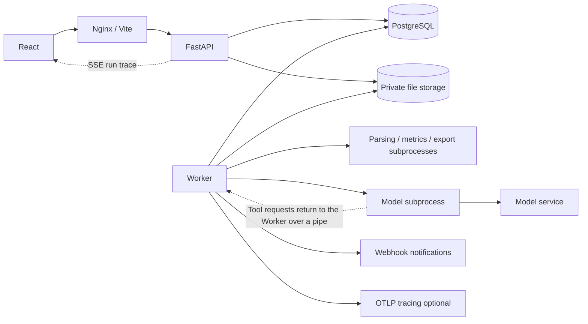

# ShopPulse Technical Documentation

[简体中文](TECHNICAL.md) | English

This document describes the implementation in the current ShopPulse source code and is intended for development, deployment and maintenance. For installation and a feature walkthrough, see the [README](../README.en.md).

[Technology stack](#technology-stack) · [Architecture and directories](#architecture-and-directories) · [Data and jobs](#data-and-jobs) · [Import and metric definitions](#import-and-metric-definitions) · [Agent and model boundaries](#agent-and-model-boundaries) · [Recommendation tracking, merchant notes and scheduled reports](#recommendation-tracking-merchant-notes-and-scheduled-reports) · [Exports](#exports) · [API and frontend](#api-and-frontend) · [Local development](#local-development) · [Operations and troubleshooting](#operations-and-troubleshooting) · [Sample data and reproduction](#sample-data-and-reproduction)

The current release is a desktop web application with a single-shop default workspace and requires a window width of at least 1024px. There is no built-in account system and no one-click Windows installer. The database must be PostgreSQL and cannot be replaced with SQLite.

Implementation baseline: database migration `0003_agent_v3`, metrics engine `2.1.0`, metric definitions `1.0`, anomaly rules `1.0`, prompts `3.1`, evidence grammar `3.0`, tools `3.0`, consent scope `2.0`. The authoritative dependency versions are in `backend/uv.lock` and `frontend/package-lock.json`.

## Technology stack

The table below lists all technologies currently in use. Versions are taken from the lock files and image tags.

| Layer | Technology | Purpose |
| --- | --- | --- |
| Runtime | Python 3.12 (image `python:3.12.12-slim`), uv 0.12.23 | Backend runtime and dependency management |
| Web framework | FastAPI 0.142, Starlette, uvicorn 0.54, python-multipart | HTTP API, uploads, Server-Sent Events |
| Data validation | Pydantic 2.13, pydantic-settings 2.15 | Request and configuration models, model output schemas, strict validation with `extra="forbid"` |
| Database | PostgreSQL 17 (`postgres:17.7-alpine`), SQLAlchemy 2.0, psycopg 3.3, Alembic 1.20 | ORM, migrations, row locks and advisory locks, durable queue |
| Computation | Pandas 3.0, NumPy, Python `decimal` | Pandas is used only for grouping and filtering; amounts remain integer minor currency units and Decimal throughout |
| File parsing | openpyxl 3.1, defusedxml, standard library `csv`/`zipfile` | Streaming reads of XLSX/CSV; rejects macros, formulas and external links |
| Process isolation | Standard library `subprocess`, line-delimited JSON over anonymous pipes, psutil 7.2 | Parsing, metrics, exports and model calls each run in a subprocess under memory and timeout monitoring |
| Credentials | cryptography 50 (AES-256-GCM, HKDF-SHA256) | Encryption of API keys and webhook URLs, key version rotation |
| Outbound network | Standard library `http.client`, `ssl`, `socket`, `ipaddress` | Self-implemented hardened HTTP client: DNS validation, pinned-IP connections, rejection of redirects and proxies; no vendor SDKs |
| Model protocols | OpenAI Chat Completions, OpenAI Responses, Anthropic Messages | Request building and response parsing for the three interfaces, with support for native tool calls and JSON Schema structured output |
| Notifications | Generic JSON webhook, Slack, Feishu, WeCom, DingTalk text messages | Push after a scheduled report completes |
| Exports | fontTools 4.66 (font subsetting), Playwright 1.63 + Chromium (PDF printing) | Offline HTML, Markdown ZIP, A4 PDF |
| Observability | OpenTelemetry SDK 1.45, OTLP/HTTP exporter | Optional tracing; local run records and trace IDs are always kept |
| Frontend | React 19.3, TypeScript 5.9, Vite 7.3, react-router-dom 7.18, TanStack Query 5.104, lucide-react, native `EventSource` | Single-page application, polling and SSE, hand-drawn SVG charts |
| Frontend testing | Vitest 5, Testing Library, jsdom, axe-core, Playwright Test 1.63 | Unit and component tests (including accessibility scans), Compose end-to-end tests |
| Frontend tooling | Prettier 3, ESLint 9 (typescript-eslint, react-hooks, jsx-a11y), openapi-typescript 7 | Formatting, static checks, request types generated from OpenAPI |
| Backend testing | pytest 9, pytest-cov, httpx, pypdf, ruff 0.16 | Regression tests on a real PostgreSQL schema, coverage thresholds, static checks |
| Deployment | Docker Compose v2, `nginxinc/nginx-unprivileged:1.28-alpine`, `node:24.14.0-alpine` (build) | Five services: db, migrate, api, worker, web |
| CI | GitHub Actions, pip-audit, npm audit | Backend, frontend, Compose browser tests, offline Agent evaluation gate |

## Architecture and directories

The React single-page application reaches FastAPI through Nginx (production) or Vite (development). The API only runs short transactions and creates jobs. A single Worker uses a PostgreSQL table as a durable queue and performs parsing, metrics, exports and model calls in subprocesses; there is no Redis or Celery. The frontend polls job status with TanStack Query, and the report run trace is additionally pushed in real time over SSE.



| Directory | Contents |
| --- | --- |
| `backend/app/api`, `core`, `db` | HTTP routes, configuration, logging, upload limits, ORM models |
| `backend/app/ingestion`, `metrics` | Parsing, validation, publishing, metrics engine and snapshot cache |
| `backend/app/providers` | Model protocol adapters, hardened outbound access, credential encryption, connection tests, mock model service |
| `backend/app/reports` | Report creation, tools and evidence, evidence grammar, multi-step loop, follow-up questions, recommendation tracking, prompt version directories |
| `backend/app/automation` | Scheduled report dispatch, webhook push |
| `backend/app/jobs`, `exports`, `ops` | Queue and Worker, export rendering, operations management and cleanup |
| `backend/app/observability` | OpenTelemetry initialization, cleanup of retained debug captures |
| `backend/app/evals`, `backend/evals` | Offline and live evaluation pipelines, synthetic cases and baselines |
| `backend/migrations`, `tests` | Alembic migrations, regression tests |
| `frontend/src/features`, `components`, `lib`, `test` | Feature pages (one directory per page), shared components, API wrappers and types, query keys, Chinese and English messages, test utilities and fixtures |
| `frontend/scripts`, `openapi.json` | Translation completeness and bundle size checks, API document snapshot (the source for generated request types) |
| `samples`, `scripts`, `docs` | Sample data, maintenance scripts, documentation and screenshots |
| `licenses`, `deploy`, `compose*.yaml` | Third-party licenses, Nginx configuration, deployment definitions |

## Data and jobs

### Data model

Business records are scoped by a server-determined `workspace_id`. Table definitions are in [models.py](../backend/app/db/models.py). There are 22 business tables:

| Table | Purpose and constraints |
| --- | --- |
| `workspaces` | Default shop, currency, time zone, retention policy and revision number |
| `uploads` | Source file hash, parsing status, private storage reference |
| `imports` / `validation_issues` | Field configuration, user decisions, source row numbers and rule codes |
| `cost_versions` / `cost_rows` | Cost versions and SKU effective periods; fingerprint is unique within a workspace |
| `dataset_versions` / `order_lines` | Order versions and normalized lines; line_id is unique within a version, with indexes on version/time and version/SKU |
| `metric_snapshots` / `metric_products` | Metric query cache and product pagination; cache_key is unique within a workspace, group_key is unique within a snapshot |
| `model_configs` | Protocol, optional review model, encrypted credentials, consent scope, capability test results; at most one default configuration per workspace |
| `reports` | Report revisions: query, rules, output language, originating schedule, frozen model snapshot and content; series_id/revision is unique |
| `agent_runs` | Budget, steps, usage, trace ID and optional retained debug capture for each execution; job_id/attempt is unique |
| `tool_results` | Frozen tool evidence; indexed on report_id/tool/args_hash for reuse |
| `report_messages` | Follow-up questions and answers; sequence is unique within a report |
| `action_items` | Action items generated from recommendations: status, note, most recent outcome assessment; position is unique within a report |
| `merchant_notes` | Merchant notes: date range, type, text |
| `report_schedules` | Scheduled reports: period, run day and time, model, language, encrypted notification URL, last and next run |
| `jobs` / `worker_pulses` | Queue, idempotency keys, leases, heartbeats; indexed on status/available_at for claiming |
| `exports` / `audit_events` | Export file status and expiry, operation audit summaries |

Publishing freezes field mappings, definitions and costs. A report freezes its query, rules, evidence, model configuration and consent scope. New files do not rewrite old reports; a new revision keeps the series ID and increments revision. Import drafts, model configurations, shop settings, action items and schedules all use `expected_revision`/`revision` to prevent overwrites. Identical input fingerprints reuse the same data version. Migration `0001_initial` creates the original 19 tables, `0002_agent_v2` adds the three tables for action items, notes and schedules together with columns for protocol, language, trace and so on, and `0003_agent_v3` adds the review model column to model configurations. Later schema changes are added as new migrations.

```text
Import: mapping_required → validating → review_required / ready → publishing → published
Report: queued → computing → analyzing → ready / ready_with_warnings / failed
Follow-up question: queued → running → ready / ready_with_warnings / failed
Job: queued → running → succeeded / failed / cancelled
```

### Queue and Worker

Job types: `parse_upload`, `validate_import`, `publish_dataset`, `build_metrics`, `test_model`, `build_report`, `report_question`, `export_report`, `notify_webhook`. The API creates jobs in short transactions. The Worker claims them with `SELECT … FOR UPDATE SKIP LOCKED`, a separate thread renews the lease by heartbeat, and result commits check the lease and fencing token so that writes from expired processes are rejected. The defaults are a 90-second lease, a 15-second heartbeat and at most 3 claims. Retries keep the job ID and do not reset the attempt count; stale retries are rejected when the configuration or resources have changed. Cancellation terminates the managed subprocess, but model requests already sent may still be billed. When consumed budget cannot be confirmed, external requests are not replayed (`MODEL_RETRY_SUPPRESSED`).

Besides claiming jobs, the Worker main loop checks for due scheduled reports every 30 seconds and cleans up expired debug captures every 10 minutes. Setting `SCHEDULER_ENABLED=false` turns off scheduling.

The publishing transaction commits the normalized lines, data version, draft status and job result together. The cost snapshot on orders comes from the cost version matched at publication, and later cost updates do not retroactively rewrite it. A data version is not a copy of the source file: after the source file is deleted under the retention policy, the normalized data and frozen reports remain.

## Import and metric definitions

Supported inputs are plain XLSX and UTF-8/BOM or GB18030 CSV. XLS, macros and encrypted workbooks are not supported. The header row can be row 1–100. The defaults are 20 MiB per file, 100,000 rows, 100 columns and 4096 characters per cell. XLSX files are limited to 50 sheets, 1000 ZIP entries and 200 MiB uncompressed in total. The parsing budget is 120 seconds / 768 MiB.

Fields and configuration are defined in [ingestion/schema.py](../backend/app/ingestion/schema.py), and the rules are implemented in [normalize.py](../backend/app/ingestion/normalize.py).

| Field group | Standard fields | Notes |
| --- | --- | --- |
| Identifiers | `order_id`, `order_line_id`, `sku` | Treated as text and leading zeros are kept; long IDs that Excel has already truncated must be corrected at the source |
| Time and quantity | `paid_at`, `quantity`, `restocked_quantity` | Payment period attribution, units purchased, units restocked |
| Payments and refunds | `line_paid_minor`, `line_refund_minor` | The source file can use major units (yuan) or minor units (fen), converted according to the selected unit; the standard field name does not determine the source column's unit |
| Allocation and derivation | `allocation_weight`, `shipping_minor`, `unit_price`, `discount_minor` | Allocation of order-level amounts, removal of shipping, derivation from unit price and discount |
| Status and display | `payment_state`, `currency`, `product_name` | Payment status mapping, currency consistency, display name |
| Cost | `sku`, `unit_cost`, `currency`, `effective_from`, `effective_to` | Unit cost is in major currency units; cost periods for the same SKU must not overlap |

`columns` maps "standard field → source column name", and the same source column cannot be mapped more than once. Alias recognition only provides suggestions; the following definitions must still be confirmed:

| Setting | Allowed values / constraints |
| --- | --- |
| `input_money_unit` / `currency_exponent` | `major` or `minor`; currency decimals 0–4 |
| `amount_scope` | Line product payment, order product payment, order payment including shipping, or derived from unit price |
| `payment_state_mode` | `mapped` or `confirmed_all_paid`; statuses map to paid/unpaid/cancelled_unpaid |
| `refund_mode` / `refund_scope` | `provided`, `unknown`, `confirmed_none`; line level or order level |
| `coverage_start` / `coverage_end_exclusive` | The declared period of complete coverage, not inferred from the first or last transaction |
| `source_as_of` | The cutoff time of the refund data, independent of the payment period |
| `cost_effective_from/to` | The range of a static cost when there is no cost time column |
| `semantics_confirmed` / `coverage_confirmed` | Explicit confirmation of the definitions and the coverage range |

The parsing preview shows at most 10 rows and does not echo the content of unrecognized columns. Quality issues record the source row number; row number 0 denotes a file or configuration problem. Files are kept in private storage, and the business API does not expose server physical paths or public links to the source files.

Conflicting lines, excess refunds, invalid quantities, mixed currencies, formulas in key fields and overlapping cost periods block publication. Duplicates, missing costs, unknown refunds and similar issues require confirmation; rows are not silently deduplicated, formulas are not evaluated and unknown values are not filled with zero. Excluded rows and warning confirmations must record a reason, and earlier decisions become invalid after remapping.

Order-level amounts are allocated with the largest remainder method, weighted by pre-discount amounts, so that totals are conserved. When an amount includes shipping, explicit shipping is deducted first. Refunds allocated to products are marked as estimates.

| Metric | Calculation |
| --- | --- |
| Product payments / Cumulative refunds | Total payments / refunds on orders paid in this period, up to the data cutoff time |
| Net sales | Product payments − cumulative refunds |
| Paid orders / Units sold | Deduplicated order count / units purchased, including orders later refunded in full |
| Net order value | Net sales ÷ paid orders |
| Net product cost | Cost per row × (units purchased − known restocked units), rounded after conversion to minor currency units, then summed |
| Gross profit / Gross margin | Gross profit = net sales − cost; gross margin = gross profit ÷ positive net sales |
| Refund amount rate | Cumulative refunds ÷ product payments |
| Cost coverage | Share of rows with a matched cost, share of payment amount with a matched cost |

Gross profit does not deduct commissions, advertising, shipping, labor or taxes. Cumulative refunds are attributed to the original payment period and are not cash refunded during the period. Order counts for individual SKUs cannot be added together directly. When costs are missing, overall gross profit is unavailable. When restocking is unknown, costs are not reversed and the result is marked as an estimate. When refunds are unknown, net sales and gross profit are unavailable. A zero denominator never returns Infinity, and full-period comparison is disabled when coverage is insufficient.

API numbers are transmitted as decimal strings. For example, `{"value":"55000","unit":"minor_currency","quality":"confirmed","unavailable_reason":null}` represents CNY 550. Quality is `confirmed`, `estimated` or `unavailable`; unavailable values are null and come with a reason.

Queries use `[start, end_exclusive)`, and the end date on pages is inclusive. Calendar days and Mondays are determined in the data version's time zone. The range is 1–366 days with at most 100 SKUs. The metric cache key includes the data and cost versions, definitions, query and engine version. The calculation budget is 120 seconds / 1536 MiB. Changes to algorithms or definitions must update the corresponding version, and product pagination does not change the overall metrics.

Metric results also include `decompositions`. Gross margin and refund rate are decomposed as "mix effect + rate effect + other" (in percentage points; the three terms sum exactly to the total change; a product that appears in only one period uses the other period's rate as its reference, and a product with a zero denominator and a nonzero numerator is counted under other). Average order value is decomposed as "unit price effect + units-per-order effect". When coverage is incomplete, the comparison period is missing or values are unavailable, a reason is given and no decomposition is calculated. Sales contribution and decomposition items carry the paid order counts for both periods so that the report layer can flag small samples.

Comparison modes are `previous`, `custom` and `none`. `previous` automatically calculates the preceding period of equal length, and `custom` requires both comparison start and end dates. SKUs are sorted and deduplicated before entering the cache key. With complete coverage and no transactions, amounts and orders are zero; when there are no records and coverage is unknown, the result must not be interpreted as zero sales. Ratios use Decimal, and comparisons are calculated before formatting. When the previous period is zero or negative, the difference and the reason the growth rate cannot be calculated are provided. Sales contribution is a descriptive decomposition and does not constitute a causal conclusion about advertising or promotion effects.

## Agent and model boundaries

Core principle: **code computes the numbers and the model explains them**. All numbers, products, dates and rule names can enter the report body only through evidence binding, and the server retrieves and renders the values. Every tool call leaves evidence with a hash. Requests, tools, rounds, bytes, tokens and time all have budgets. Since 3.0, causes proposed by the model are also decided by code: a hypothesis carries a machine-checkable expectation, and the server runs the test and judges it supported, refuted or inconclusive.

### Tools

The server first runs seven core tools and saves their evidence (this does not count against the model's tool budget). The model then calls tools as needed through hypothesis tests or a restricted loop:

| Tool | Arguments | Output |
| --- | --- | --- |
| `get_data_quality` | None | Summary of coverage, warnings and excluded rows |
| `calculate_metrics` | None | Metrics for the current and comparison periods |
| `get_sales_trend` | Optional sub-range within the report period, metric subset (≤6) | Daily trend |
| `rank_products` | Metric, direction, count (1–50) | Product ranking |
| `compare_periods` | Optional metric subset | Differences, growth rates and reasons a comparison is not possible |
| `decompose_sales_change` | None | Descriptive contributions of products, order count and average order value |
| `detect_anomalies` | None | Rules, thresholds, triggered items and limitations |
| `inspect_sku` | SKU | Two-period metrics, comparison and daily trend for one product (drill-down) |
| `refund_breakdown` | By SKU or by day, count (1–10) | Products or dates with the most refunds |
| `cost_coverage` | Count (1–10) | Products with missing costs and their sales |
| `explain_metric` | Metric name | Server-maintained description of the metric definition, with no numbers |
| `check_recommendation` | None | Earlier recommendations due for review and the values of their verification metrics when proposed and in this period |
| `get_merchant_notes` | None | Merchant notes that overlap the current or comparison period |
| `decompose_metric_change` | Metric (gross margin, refund rate, average order value) | Mix effect and rate effect (by SKU), or unit price and units-per-order effects |
| `get_history` | None | Shop-level metrics for up to 8 windows of equal length before this period (most recent first) and the number of consecutive periods each metric has moved in the same direction |
| `derive` | Operation and two evidence paths | Difference, ratio, multiple or share of two existing values (computed bindings are usually used directly) |

When `refund_breakdown` runs by SKU, it includes comparison-period values and the change in refund rate. Rankings, contributions, decompositions and drill-down results output by SKU carry a `sample` flag: `low` means that the larger of the two periods has fewer than 10 paid orders.

**History windows** are calculated when a report is first generated, before the report transaction begins. Using the length of the current period as the window, the server takes up to 8 preceding windows (with a total span of no more than 366 days), aggregates them in an isolated metrics subprocess against the frozen data version, and freezes the result with the `get_history` evidence. All metrics in a window with incomplete coverage are marked unavailable. When history exists, `get_history` runs in advance as core evidence.

When earlier recommendations are due or merchant notes overlap, `check_recommendation` and `get_merchant_notes` also run in advance on the server. The server also has two internal tools, `test_hypothesis` and `recheck_hypotheses` (not offered to the model); see the hypothesis tests section below. `inspect_sku` is recalculated by the Worker process with the metrics engine from that SKU's order lines in the frozen data version. It reads at most `DRILL_ROW_LIMIT` rows per call and returns `ROWS_LIMIT` when the limit is exceeded; the SKU must be within the report scope. The remaining tools read only the report context. Within a report, the same tool with the same arguments (by argument hash) reuses existing evidence, with no recalculation and no duplicate record. Follow-up questions reuse the evidence produced during the report run. Tools have no permission to execute arbitrary code, SQL, files or network calls.

Evidence records the ID, report, data version, query scope, tool version, arguments and their hash, and the result and its hash. The hash is used for consistency checks and is not a digital signature.

### Anomaly rules

The default rules are: sales change ≥20%, refund rate ≥10%, gross margin decline ≥5 percentage points, confirmed negative-margin products, top-three SKU concentration ≥70%, and a MAD outlier ≥3.5 against the preceding 28 complete days. Each rule checks its own prerequisites such as sample, coverage and costs, and reports insufficiency when support is lacking. The normal minimum sample is 20 orders, and concentration requires at least 5 active SKUs. MAD does not expand the query range and is not calculated when history is insufficient, MAD is zero or the granularity is weekly. Thresholds are frozen with the report, and rule limitation notes are output in the report language.

### Budgets

The model stage of each report is limited to **8 tool calls, 5 tool rounds, 3 parallel calls per round, 8 model requests, 2 repairs and 10 hypothesis tests (at most 5 per wave, 2 waves in total)**. Follow-up questions are limited to **4 tool calls, 2 rounds, 5 requests and 1 repair**, and run no new hypothesis tests. Cumulative input/output is limited to **480000/64000 UTF-8 bytes** (each round resends the whole conversation, so input bytes are counted cumulatively). When the provider returns usage, input/output is additionally limited to **120000/80000 tokens**. The output limit parameter for a single request is 4000 (16000 for Anthropic when no length parameter is configured: adaptive thinking counts against the same limit, and at 8000 Haiku's thinking truncates the JSON). A reply truncated by reaching the limit is recorded as `OUTPUT_TRUNCATED` (Anthropic `stop_reason: max_tokens`, OpenAI `finish_reason: length`) and is no longer misreported as a format error. Output bytes count only the reply body and tool calls, and exclude provider-added fields such as `reasoning_content`. Token usage is counted from the values the provider returns, and reasoning tokens for reasoning models are usually included. The internal deadline of the model subprocess is about 585 seconds and that of the parent process about 595 seconds; the 600-second budget excludes queueing and independent metric calculation. A connection test is limited to 8 synthetic requests, a budget of about 100 seconds and a 110-second subprocess deadline.

### Prompts and capability strategy

Prompts are stored by version in [app/reports/prompts](../backend/app/reports/prompts) (four files: shared rules, report, follow-up question, review). Changing a prompt requires a new version directory and raising `PROMPT_VERSION`, and the report snapshot records the version used.

The connection test probes, in order, basic responses, tool calls and result return, JSON mode (skipped for Anthropic), JSON Schema structured output, and a text JSON fallback. The capability strategies, in order, are `native_tools` (native tool calls), `restricted_json` (the model requests tools with a `{"tools":[...]}` JSON envelope) and `narrative` (no tools offered). Final output prefers JSON Schema strict mode and then JSON mode. When the requested output constraint is rejected (`UNSUPPORTED_REQUEST`, for example because tools and output constraints cannot be combined or the service considers the structure too large), the request is retried once without the output constraint, and the reply is still fully validated on the server. The report and follow-up question schemas extract repeated sentences and bindings into shared `$defs` (about 2.7 KB, compared with about 7 KB inlined): Anthropic compiles strict schemas into a grammar, and the inlined version was rejected as "grammar too large". The per-socket timeout is 5–300 seconds with a default of 120 seconds (it was 45 seconds before 3.0.0, and existing configurations keep their original value). The service is non-streaming, and a model with thinking often needs more than a minute to write a report, so 45 seconds would time out long writing calls. The response limit is 1 MiB. Only rate limits and service errors allow one brief retry. Passing the probes does not guarantee that an actual report will pass.

The model output structure is defined in [reports/schema.py](../backend/app/reports/schema.py):

| Output | Required content |
| --- | --- |
| `summary[]` | One to four sentences with bindings |
| `findings[]` | ID, topic (sales/refund/cost/product/period/quality/followup), title, observation, at most three supporting sentences, at most three unverified hypotheses, at most three supported `hypothesis_ids`; one to five items |
| `recommendations[]` | Action sentence, linked observation ID, priority, effort, verification metric, review period; one to four items |
| `ruled_out[]` | Refuted hypothesis ID and a one-sentence explanation; at most four items |

### Evidence grammar

The model writes sentence templates containing `{{placeholder}}` markers. Each placeholder is bound to one evidence record and one allow-listed path. The server resolves the path, checks that the type and format agree, and renders the sentence. The implementation is in [grammar.py](../backend/app/reports/grammar.py).

```json
{"template": "The top SKU by net sales is {{sku}}, with net sales of {{sales}}.",
 "bindings": [
   {"name": "sku", "evidence_id": "<id>", "path": "items.0.sku", "format": "entity"},
   {"name": "sales", "evidence_id": "<id>", "path": "items.0.current.metrics.net_sales", "format": "money"}]}
```

| format | Bindable values | Rendered example |
| --- | --- | --- |
| `money` / `count` / `percent` | Metrics, amount fields, ratios and growth rates, distinguished by unit | `CNY 550.00`, `111`, `+10.00%`; estimated values have ` (est.)` appended |
| `pp` | Percentage-point change in a ratio | `+1.82 pp` |
| `entity` | SKU; also product name when consent includes product names | `A` |
| `date` | Trend points and outlier dates | `2026-10-01` |
| `label` | Rule codes, rule states, quality warnings, metric names, review results, note types | `negative-margin products`, `triggered`, `improved` |
| `multiple` | Multiples from computed bindings or derived evidence | `2.35 倍` ("2.35 times", in Chinese reports), `2.35×` |
| `note` | Original text of a merchant note, an earlier recommendation or an earlier hypothesis (truncated to 120 characters and quoted) | `“National Day discount”` |

`label` also covers hypothesis states (`supported by data`, `ruled out`, `inconclusive`) and trend directions (`rising`, `falling`, `flat`).

**Computed bindings**: a binding can carry `derive: {"op": "diff" | "ratio" | "multiple" | "share", "b": {"evidence_id", "path"}}`. The binding's own value is a, `b` is the other value, and the server calculates and renders the result. Both operands must be numeric paths on the allow list and have the same unit. `diff` requires the same metric (the difference between two ratios is output in percentage points). `share` requires the same metric and the same period, the denominator must be a shop-total path or a total in the same evidence, and the part must not exceed the total. A zero or negative denominator or an unavailable value is rejected. The result is recorded as `derive` evidence (its ID is determined by the operation and the source hashes, so repeating a calculation yields the same record), and the sources can be viewed in the evidence drawer. Words such as 翻倍 ("doubled") and 一半 ("half") remain on the forbidden-word list, and a multiple can only be produced through a binding that renders `倍` ("times") or a percentage.

**Small samples**: when a change value in a sentence comes from a product marked `sample: low` and all bindings in the sentence come from small-sample products, summaries, observations and supporting sentences are judged `LOW_SAMPLE_ONLY`. A shop-level binding must be added, or the sentence must be rewritten as an unverified hypothesis.

Validation checks, in order: placeholders and bindings correspond one to one (at most four bindings per sentence); `evidence_id` belongs to this report, and the evidence's report, data version, query scope and result hash are consistent; `path` matches the tool's allow list of bindable paths (thresholds, arguments, hashes and the like cannot reach the report body); the path resolves and the value type agrees with `format`, and unavailable metrics cannot be bound; templates with placeholders removed, titles and other free text must not contain numbers (including Chinese and full-width numerals), English number words, percent signs, URLs, the word `SKU`, or certainty claims such as 保证 ("guarantee") and 必然 ("inevitably"), and must not directly write any SKU or product name that appears in the evidence; summaries, observations and supporting sentences need at least one binding, while hypotheses and recommendations may have none.

Validation collects all problems and their locations in one pass (for example `findings[0].supporting[1].bindings[0]: WRONG_FORMAT`), which enables targeted repair. `PATH_NOT_ALLOWED` and `PATH_NOT_FOUND` include the closest bindable path in that evidence, and `UNBOUND_NUMBER_OR_CLAIM` names the word that matched (only the fragment the rule matched is echoed). Prompt 3.1 spells out the rules English most easily trips: do not write the word "SKU", avoid compounds containing a number word such as "one-off", and use at most four bindings per sentence. The model sees a projection of the core evidence: evidence IDs and the original path structure are kept, while order IDs, source row numbers and unauthorized product names are removed. Lists are only truncated at the tail, so the remaining paths stay valid after truncation, and rule checks and warning lists are never truncated. The model's full replies and internal reasoning are not saved as report content.

### Hypothesis tests

The implementation is in [hypothesis.py](../backend/app/reports/hypothesis.py). A hypothesis consists of a statement (in the evidence grammar, with optional bindings), a test (one read-only tool call) and an expectation:

| Expectation | Meaning |
| --- | --- |
| `gt` / `lt` | a is greater than / less than b or a threshold (default 0; "greater than 0" on a level value is trivial and rejected, while falsifiable expectations such as "gross profit less than 0" are allowed) |
| `abs_ge` / `abs_gt` | \|a\| ≥ threshold / \|a\| > \|b\| (for example, the mix effect is larger than the rate effect) |
| `share_ge` | a ÷ b ≥ threshold (0–1), calculated under the `share` rules |
| `rank_le` | The element selected by key is within the first k positions of the list |
| `same_sign` | a and b change in the same direction |

Operands take the form `{source, path, select}`. `source` is `test` (this hypothesis's test result) or an existing evidence ID, and at least one operand must come from `test`. `select` chooses a list element by `sku`, `start`, `code` or `date`, so that positions do not shift with the data. Paths must be on the evidence grammar allow list. The server runs the test and judges it. The result is "Inconclusive" when a value is unavailable, the key is not found, or the change value comes from a small-sample product. In lists that show only nonzero items and were not truncated by `top_k`, such as the refund breakdown and cost coverage, a selected product that cannot be found makes expectations such as "Greater than" and "Share at least" refuted (`NOT_PRESENT`). In a share expectation, a part that exceeds the total (because other products moved in the opposite direction) is treated as a share above the threshold. Estimated values are judged as usual and marked as estimates. The verdict is saved as `test_hypothesis` evidence (including the rendered statement, operand values, derived values such as the share, and the test specification with positional references anchored to key selections), and `state`, `derived` and `operands.N.value` can be bound. "Supported by data" means only that the data is consistent with the statement and does not prove causation.

**Server-side candidates**: based on the rules that fire, the deterministic stage first proposes and tests up to 5 candidate hypotheses (sales change: whether order count or average order value dominates, whether the change is concentrated in a single product, whether unit price or units per order dominates; high refunds: whether they are concentrated in a single product, whether per-product refund rate or mix dominates; notable gross margin change: whether mix or rate dominates). Reports without a model also show these verdicts.

**Earlier-period recheck**: a new revision in the same series (including scheduled reports) takes the supported or refuted hypotheses from the previous completed revision (at most 5, with model-proposed hypotheses first), judges them again on the current period's data using the anchored specifications, and writes the results to the `recheck_hypotheses` evidence and the report's "Earlier hypotheses re-checked" section.

### Multi-step loop

The implementation is in [workflow.py](../backend/app/reports/workflow.py). Every step is written to the run record (`agent_runs.steps`), appended in real time while the Worker runs, and shown step by step on the report page. Reports with a capability strategy of `native_tools` or `restricted_json` use the hypothesis loop:

1. **Plan** (`phase: plan`): the model sees the core evidence projection, fact sentences, the verdicts for server-side candidates and the tool catalog, and replies with `{"hypotheses": [...]}`, at most 5 items. On a format error it is prompted once, and if it still fails, the run falls back to the tool loop described below.
2. **Test**: the server runs and judges each test, and returns the results (verdict summaries and projections of the test evidence) to the model in one message. Tests run in the parent process and do not consume the model's tool budget, so a single model request no longer corresponds to a single tool call.
3. **Refine** (`phase: refine`, optional): when supported hypotheses exist and budget remains, the model can build on them with up to 3 more (going from shop-level drivers to a specific SKU or date). An empty list goes straight to writing.
4. **Write** (`phase: write`): the model writes the final report. Findings can cite only supported hypotheses, and `ruled_out` can cite only refuted hypotheses.
5. **Validate and repair**: when the final output fails validation and all problems are located in specific sentences or fields, the model is asked to return patches for only those locations (`{"patches": [...]}`), and the server merges them and revalidates the whole report. Otherwise the model is asked to rewrite the entire JSON. At most 2 repairs are made, and server messages do not echo the model's original text. If repair still fails, `EVIDENCE_VALIDATION_FAILED` is recorded and the report keeps its deterministic results.
6. **Review**: after validation passes, deterministic checks run: prose whose direction contradicts the bound change value (`DIRECTION_MISMATCH`), a recommendation whose verification metric does not measure the topic of its linked finding (`NO_VERIFICATION`), and a cited merchant note that mentions a different product (`WEAK_NOTE_LINK`). When the model configuration specifies a review model and the connection test has confirmed it is usable (`review_usable`), that model then independently reads the rendered text. Deterministic issues or important issues from the review model trigger one patch repair. After the repair, the report must pass validation again and deterministic issues must not increase; otherwise the original draft is kept.

A typical hypothesis loop makes three requests: plan, refine and write. The `narrative` strategy and follow-up questions use the tool loop: the model can request at most 3 tools per round (exceeding this returns `TOO_MANY_PARALLEL_CALLS`), and duplicate calls return `DUPLICATE_CALL`. When a round yields no new evidence, the round limit is reached, the budget is nearly used or too little time remains, tools are closed (`tool_choice=none`) and final JSON is requested, with validation and repair as above.

When a conversation exceeds 64 KB, tool results from before the current round are replaced with "evidence ID plus a summary of the first few items", and the full results remain in the evidence. Anthropic Messages is an exception: history is append-only and assistant turns are replayed verbatim (including thinking blocks), because rewriting history would invalidate the thinking blocks. In that case the length is controlled by the closing conditions.

**Prompt caching**: the system prompt and initial evidence are always the first two messages of each request. Anthropic Messages requests add one `cache_control: ephemeral` breakpoint after the tools and system prompt and another after the first data message. OpenAI services cache stable prefixes automatically. Each model request in the run record stores `cached_tokens` (when the provider returns it).

The model loop runs in a separate subprocess. Only the subprocess holds the key and accesses the network. All tools are requested from the parent process (the Worker) over a line-delimited JSON protocol on an anonymous pipe, so the drill-down tool can read the database while the model process cannot. The subprocess returns only raw output, and the parent process revalidates it against its own evidence; a validation failure is recorded as `PARENT_VALIDATION_FAILED`.

### Follow-up questions

A follow-up question can be up to 2000 characters. Each report handles one at a time and uses the follow-up budget. Hypotheses judged during the report stage are provided with the initial evidence, and answers can cite supported hypotheses in findings. The server first intercepts two kinds of questions with rules: questions that need advertising, traffic or inventory data get a direct explanation of the missing data, and questions that clearly concern another date range get a prompt to create a new analysis when sending the original question is not authorized. All other questions go to the model. Answers use the same evidence grammar as reports and can call further tools to drill down. There are three outcomes:

- `answer`: one to four sentences with bindings, optionally with observations and recommendations.
- `clarify`: a clarifying question with at most three options; selecting one in the frontend fills in the question box.
- `suggested_query`: a suggested date and SKU scope with a reason; the frontend generates a prefilled link to a new analysis, and the original report is unchanged.

When the model degrades or none is configured, `fallback` is returned: verifiable fact sentences from the original report are rendered according to the question's topic (sales, refunds, costs, products). A historical report also degrades in this way when it finds that the model configuration's revision has changed.

### Consent scope

The consent record (`consent`) of a model configuration is version `2.0`. Its fields are aggregated metrics, quality summaries, SKUs, follow-up question text and merchant notes, plus product names when product name mode is enabled. Once authorized, the original question and the last three rounds of questions and answers (the server-rendered answer text) are sent as data. For configurations confirmed under an older version, `consent_current` is false: the Models page shows "Confirm the new data scope" (`POST /model-configs/{id}/consent`). Confirmation updates only the consent record and does not change the service URL, key, capability test results or revision. Each report uses the consent frozen at its creation: follow-up questions on reports under the older consent send only the question topic, and the report page and the new report form display a notice.

### Model protocols

| Protocol | Request path | Authentication and version | Structured output |
| --- | --- | --- | --- |
| `openai_chat` | `{base URL}/chat/completions` | `Authorization: Bearer` | `json_schema` (strict) or `json_object` in `response_format` |
| `openai_responses` | `{base URL}/responses`, `store: false` | `Authorization: Bearer` | `json_schema` (strict) or `json_object` in `text.format` |
| `anthropic_messages` | `{base URL}/messages` | `x-api-key`, `anthropic-version: 2026-10-21` | `json_schema` in `output_config.format` |

The implementation is in [protocols.py](../backend/app/providers/protocols.py). The loop uses a unified internal message format and converts requests and parses responses per protocol. Refusals are recorded as `MODEL_REFUSED`. All three protocols send HTTP requests directly through the same hardened outbound layer, with no vendor SDK. Current Anthropic models do not accept a forced tool choice, so the connection test prompts for the call instead; `tool_choice: none` closes tools at the end of a run; and input token counts include cache reads and writes. Sampling parameters such as temperature are not set. A model configuration can specify a **review model** under "Advanced settings" (a cheaper model ID on the same service). It shares the URL, key and consent scope with the main model and receives only the rendered report text and hypothesis verdicts. When left blank, it is not called. The last step of the connection test probes it with the same request shape as a review call (shown as the "Review model" stage), and the result is recorded as the `review_usable` capability. A failed probe disables only the review and does not affect the availability of the main model. Configurations tested on an older version without this flag are treated as unusable; retesting enables it.

### Output language

When creating a report, Chinese or English can be selected, with the interface language as the default. The language determines the writing language required by the prompts, the server-rendered labels (rules, states, warnings, metric names, review results, note types), the percentage-point unit, the estimate marker, fact sentences, fixed limitation notes and the limitation notes of anomaly rules. Exports likewise output section titles, table headers, units, chart text and the `lang` attribute in the report language. Product names, merchant notes and report titles stay in their original text.

### Credentials and outbound access

API keys are protected with AES-256-GCM, HKDF-SHA256 and a secret master key. The associated data binds the workspace, configuration ID and key version. Keys are passed to the model subprocess through stdin and are never echoed or logged. By default, models can only use public HTTPS on port 443: DNS results are validated on every connection, connections go to a pinned IP, TLS is verified, private, reserved and transition ranges are rejected, and redirects and environment proxies are rejected. Exact internal origins are authorized with `MODEL_ALLOWED_ORIGINS`. Logs do not record request bodies, credentials or full provider replies. 422 errors do not serialize Pydantic details, to avoid leaking a submitted key.

## Recommendation tracking, merchant notes and scheduled reports

**Action items.** After a report completes, each recommendation (including the fixed recommendations used when there is no model) generates an action item with a verification metric and a review period. Merchants can mark it Open, Completed or Dismissed on the report page or the Automation page and add a note. Changes use revision to prevent overwrites. Action items are deleted together with their report.

**Outcome review.** When a new report is generated, the server finds earlier action items in the same shop that have not been dismissed and whose source report period ended before the current period began (`next_month` recommendations must also be at least 28 days apart, with at most 10 items). It compares the values of their verification metrics when proposed and in the current period: lower is better for the refund rate and higher is better for the others. When the SKU scope or currency differs or a value is unavailable, the result is "Insufficient data". The result is "Improved", "Not improved" or "Insufficient data", and it is written to the report's "Earlier recommendations" section, the `check_recommendation` evidence and the action item's latest assessment. This is a descriptive comparison and cannot prove that the recommendation caused the change.

**Merchant notes.** Merchant notes record five kinds of context: promotion, holiday, stockout, price change and other. The range is 1–366 days and the text is at most 300 characters. Notes that overlap the current or comparison period (at most 20) enter the report and the `get_merchant_notes` evidence, and the model can bind their original text in hypotheses using the `note` format.

**Scheduled reports.** Each schedule specifies a data version (or always uses the latest version), model, number of days analyzed (1–31), run day and time (in the shop time zone), output language and anomaly rules. Each workspace can have at most 20 schedules. The Worker checks for due schedules every 30 seconds. A run takes the most recent days ending at the data coverage end date and compares them with the previous period of equal length. It is skipped when the data version and end date match the last report (no new data). Reports from the same schedule are consecutive revisions in one series, and "Run now" forces generation. Row locks and idempotency keys ensure that multiple Workers do not generate duplicates. A schedule is automatically disabled when its data version is deleted, and a model configuration that a schedule references cannot be deleted.

**Notifications.** After a report completes, if the schedule has a notification URL, the Worker runs a `notify_webhook` job that pushes the title, period, first four summary sentences and report link in the selected format (Generic JSON, Slack, Feishu, WeCom, DingTalk). The URL is stored encrypted with the same master key as model keys, is never echoed, and is rotated along with the keys. Delivery uses the same outbound policy and allows only public HTTPS; internal bot URLs must be added to `MODEL_ALLOWED_ORIGINS`. The timeout is 10 seconds, response bodies are not saved, and failures are not retried automatically (the job can be retried on the Operations page).

## Exports

Exports share the frozen report, do not call the model again, and are rendered in a monitored subprocess. HTML is a single-file offline page: server-side templates, escaped data, a Noto Sans SC font subset for the report text, and SVG charts are embedded as data URIs, with a CSP that forbids scripts and network access. The Markdown ZIP contains `report.md`, `evidence.json` and two SVG files. The PDF is printed offline in A4 by Playwright Chromium with network requests blocked. The sections are Overview, metrics table, Trend and sales contribution, Products, Anomalies and limitations, Findings and recommendations (including supporting facts, supported hypotheses and hypotheses to verify), Hypothesis tests and Causes ruled out, Earlier hypotheses re-checked, History windows, Earlier recommendations, Merchant notes and Evidence appendix. Exports are retained for 30 days by default, and downloading an expired export returns 410.

## API and frontend

The interface prefix is `/api/v1`. Success returns `{"data":...,"meta":{"request_id":"..."}}`, and errors return `{"error":{"code":"...","message":"...","retryable":false},"meta":...}`; 204 responses, downloads and SSE are exceptions. Write requests need an exact Origin. Reports, follow-up questions and exports use an `Idempotency-Key` of 8–128 characters, and reusing a key with different parameters returns 409.

| Resource | Main paths |
| --- | --- |
| Health, shop, jobs | `/health/live`, `/health/ready`, `/workspace`, `/jobs`, `/jobs/{id}` |
| Uploads and imports | `/uploads`, `/imports`, `/imports/{id}`, with subpaths `/mapping`, `/resolutions`, `/validate`, `/publish`, `/issues`; `/samples/{filename}` |
| Versions and metrics | `/datasets`, `/datasets/{id}`, `/datasets/{id}/skus`, `/cost-versions`, `/metrics/query`, `/metrics/{id}`, `/metrics/{id}/products` |
| Models | `/model-configs`, `/model-configs/{id}`, `/model-configs/{id}/test`, `/model-configs/{id}/consent`; configurations include `protocol` and `consent_current` |
| Reports | `/reports`, `/reports/{id}`, with subpaths `/runs`, `/runs/{run_id}/events` (SSE), `/actions`, `/evidence/{evidence_id}`, `/messages`, `/exports` |
| Scheduled reports | `/schedules`, `/schedules/{id}`, `/schedules/{id}/run` |
| Merchant notes and action items | `/notes`, `/notes/{id}`, `/actions?status=open|done|dismissed|all`, `/actions/{id}` |
| Downloads, operations | `/exports/{id}/download`, `/operations/status`, `/operations/settings`, `/operations/audit` |
| Jobs and cleanup | `/operations/jobs/{id}/cancel`, `/retry`; `/operations/cleanup`, `/operations/deletion/{kind}/{id}` |

For specific methods and fields, see [Swagger](http://127.0.0.1:8000/docs) on the development API. Setting `model_config_id: null` when creating a report explicitly selects no model. A new revision must provide `parent_id` and a complete query. `language` is `zh` or `en`.

Common request sequence:

1. `POST /uploads` with multipart `kind=orders/costs` and the file; poll `GET /uploads/{id}`.
2. `POST /imports` creates a draft; `PUT /imports/{id}/mapping` submits `expected_revision` and config.
3. `POST /imports/{id}/validate` starts validation; if needed, PUT resolutions and validate again.
4. `POST /imports/{id}/publish` publishes; poll the draft until it is published and obtain the version ID.
5. `POST /metrics/query` retrieves or triggers a metric snapshot; use the returned snapshot ID to poll the metrics and product pagination.
6. `POST /reports`, `POST /reports/{id}/messages` and `POST /reports/{id}/exports` create asynchronous work; poll the report, message list or export list respectively. While a run is in progress, subscribe to `/reports/{id}/runs/{run_id}/events` to view its steps.

Example of creating a report (`POST /api/v1/reports`, also with Origin and a unique Idempotency-Key):

```json
{
  "title": "经营周报",
  "query": {
    "dataset_id": "替换为已发布订单版本的 UUID",
    "start": "2024-01-01",
    "end_exclusive": "2024-01-08",
    "comparison": "previous",
    "skus": [],
    "granularity": "day"
  },
  "model_config_id": null,
  "parent_id": null,
  "rules": {"min_orders": 20},
  "language": "zh"
}
```

In this example, the `title` value means "Business weekly report", and the `dataset_id` value is a placeholder meaning "replace with the UUID of a published order version".

A follow-up question request is `{"question":"What should I review about refunds?"}`, and an export request is `{"format":"html"}` (markdown and pdf are also accepted). The SSE stream checks for steps once per second, sends `event: step`, sends `event: done` when the run ends, sends a comment heartbeat every 10 seconds, and sends `event: timeout` after 600 seconds. Cleanup or linked deletion requires a GET preview first, then a POST of `{"token":"value returned by the preview","confirmation":"确认删除"}` (the required value `确认删除` means "confirm deletion"). Changes to linked resources or configuration invalidate old tokens. HTTP 202 only means that the job has been submitted and must not be treated as business success; the final outcome is determined by the resource status and error code.

Frontend pages are Overview, Data, Dashboard, Reports, Automation, Models and Operations. They are lazy-loaded by route, with one directory per page. A single source file has at most 300 lines (ESLint `max-lines`), and chart components only receive data and do not send requests. `lib/api.ts` centralizes requests. Request bodies and response types are all generated into `lib/schema.ts` from `frontend/openapi.json` by `npm run api:types` (`scripts/export_openapi.py` exports that file from the backend, and CI checks that neither is stale). Response structures are declared with Pydantic in [api/responses.py](../backend/app/api/responses.py), which only describes the existing output of the interfaces and does not change it: [response_guard.py](../backend/tests/response_guard.py) compares the serialized results before and after the declaration byte by byte on every test request. Free-form structures such as report content, evidence and snapshots are `{ [key: string]: unknown }` in the generated types, and `lib/types.ts` uses `Refine` to add the fields that pages read. Query keys and polling rules are centralized in `lib/queries.ts` (detail keys hang under list keys, so one invalidation refreshes both; polling happens only when existing data shows a job in progress, and load failures do not retry indefinitely). Dates, error messages and loading states use `lib/dates.ts` and `components/`. The URL preserves Dashboard filters. `lib/i18n.ts` and the message dictionary manage Chinese and English, localStorage stores only `shoppulse.language`, and switching language does not remount pages, lose form input, or translate user data and historical reports. Pages poll through TanStack Query, and the report run trace additionally subscribes to SSE with `EventSource`, falling back to polling when the browser does not support it or the connection fails. React handles formatting and drawing and does not recalculate authoritative amounts. New states or error messages must be added to both the Chinese and English messages, and translations should not be frozen at module initialization. `npm run check:i18n` finds Chinese strings without an English translation (including label tables later passed to `t()`), and `--strict` also rejects translations that are no longer used. When the same Chinese text has different meanings in different contexts, different Chinese keys are used to distinguish them. The report evidence drawer shows readable summaries for derived calculations, hypothesis tests, history windows and earlier-period recheck evidence, and keeps the raw data.

Styles use CSS Modules (one `*.module.css` per page or component) plus three global stylesheets: [tokens.css](../frontend/src/styles/tokens.css) contains the design tokens for all colors, corner radii, shadows and spacing (colors are named by hue and CIE L* lightness, and colors with a ΔE2000 difference below 2 are merged into one token), while `global.css` and `tables.css` hold element-level base styles. Component tests (Vitest + Testing Library) use MSW to replay [src/test/api.json](../frontend/src/test/api.json). That file is recorded by the backend test `test_visual_fixtures.py`, which calls the real API; after an interface changes, simply record it again, and any request that gets no response fails the test. Visual regression (`npm run test:visual`) uses the same recorded data on the build output to capture full-page screenshots of 12 pages each in Chinese and English, and runs axe checks on each page (serious and critical issues fail). Font rendering varies by system, so baselines are saved per platform, and the Linux baselines are generated in the Playwright container used by CI (`npm run test:visual:linux -- --update-snapshots=all`).

## Local development

Python 3.12, uv, Node.js 24 (minimum 22.12) and PostgreSQL 17 are required. You can use Docker to start only the development database, or run everything natively.

The commands below assume Windows PowerShell. First initialize the configuration in the root directory; existing configuration and keys are kept:

```powershell
if (-not (Test-Path .env)) { Copy-Item .env.example .env }
python scripts/init_secrets.py
```

When using the Docker development database, continue with:

```powershell
docker compose -f compose.dev.yaml up -d --wait
Set-Location backend
uv sync --frozen
uv run playwright install chromium
uv run alembic upgrade head
Set-Location ../frontend
npm ci
```

On Linux, install Chromium with `uv run playwright install --with-deps chromium`. The development database is at `127.0.0.1:5433` and is separate from the full Compose database.

Start the following in three separate terminals:

```powershell
# backend directory: API
uv run uvicorn app.main:app --host 127.0.0.1 --port 8000 --reload --no-access-log --no-proxy-headers
# backend directory: Worker (another terminal)
uv run python -m app.jobs.worker
# frontend directory: pages (another terminal)
npm run dev
```

Open [http://localhost:5173](http://localhost:5173); Vite proxies `/api`. The full Docker web service does not proxy Swagger. The virtual environment may depend on `.cache/python`, so check `backend/.venv/pyvenv.cfg` before cleaning up.

### Running without Docker

1. Install and start a local PostgreSQL 17 and confirm the port it actually listens on (usually 5432). Python, uv and Node.js must be available on PATH.
2. Complete the `.env` and key initialization above. Using a database management tool, create a login role `shoppulse` whose password is the content of the local `secrets/database_password`, and create a `shoppulse` database owned by that role. The password file must be at least 32 characters. Do not hard-code real passwords in documents or on the command line.
3. Set the following in `.env`, adjusting the port to match your installation:

```dotenv
DATABASE_HOST=127.0.0.1
DATABASE_PORT=5432
DATABASE_NAME=shoppulse
DATABASE_USER=shoppulse
DATABASE_PASSWORD_FILE=secrets/database_password
CREDENTIAL_MASTER_KEY_FILE=secrets/credential_master_key
APP_PUBLIC_URL=http://localhost:5173
STORAGE_ROOT=data
```

4. In backend, run `uv sync --frozen`, `uv run playwright install chromium` and `uv run alembic upgrade head`; in frontend, run `npm ci`. On Linux, install Chromium with `--with-deps`.
5. Start the API, Worker and frontend with the three terminal commands above and open `http://localhost:5173`. Check `http://127.0.0.1:8000/api/v1/health/ready`, and confirm on the Operations page that the Worker is online.

This approach is a native development setup; stop each process with Ctrl+C in its terminal. There is no automatic installer or Windows service management yet. Do not assume that an existing Docker data volume is the data of the local PostgreSQL; the two instances are independent. `scripts/backup.py` only serves Compose instances. A native deployment must back up the database, STORAGE_ROOT and keys together after stopping application writes.

### Mock model and tests

```powershell
# Project root; use a separate test instance, because browser tests write sample data
docker compose -f compose.yaml -f compose.mock.yaml up -d --build
```

On the Models page, enter `http://mock-provider:8099/v1`, leave the key blank and use the model name `full`. The mock service provides `/v1/chat/completions`, `/v1/responses` and `/v1/messages` at the same time, so any protocol can be selected. The model name determines the behavior: `agent` demonstrates multi-step drill-down (refund breakdown, product ranking, SKU drill-down and one rejected duplicate call), `clarify` and `suggest` demonstrate clarifying questions and suggested scopes in follow-up questions, `no-tools` / `text-json` and `narrative` demonstrate degradation strategies, and `auth-fail`, `missing`, `rate-limit`, `unavailable`, `redirect`, `invalid`, `bad-number`, `foreign-evidence`, `unsafe-tool`, `malformed-report` and `repair-once` demonstrate various failures.

For a native mock, set `MODEL_ALLOWED_ORIGINS=["http://127.0.0.1:8099"]`, restart the API and Worker, run `uv run python -m app.providers.mock_server` in backend, and change the model base URL to `http://127.0.0.1:8099/v1`.

```powershell
# backend directory; start the development database first
uv run ruff check .
uv run ruff format --check .
uv run alembic check
uv run pytest -q --cov=app.metrics --cov=app.ingestion.normalize --cov-branch --cov-report=json:coverage.json
uv run python ../scripts/check_coverage.py coverage.json
uv run python -m app.evals run --gate

# frontend directory
npm run format:check   # or npm run format to format automatically
npm run lint
npm run check:i18n -- --strict
npm test
npm run build
npm run check:bundle  # entry gzip ≤ 135 kB, other chunks ≤ 40 kB
npm run test:visual   # local platform baseline; npm run test:visual:linux runs in the Linux container used by CI
# After a backend interface change: run export_openapi.py in the root directory, then npm run api:types in the frontend directory
npx playwright install chromium
$env:E2E_BASE_URL = 'http://localhost:8080'
$env:E2E_MODEL_BASE_URL = 'http://mock-provider:8099/v1'
npm run test:e2e
```

The backend has 273 pytest cases, which run real migrations in a random PostgreSQL schema and compare every JSON response against the declared response structure. The frontend has 24 Vitest cases, 24 visual regression screenshots and 7 Playwright end-to-end cases. The line and branch coverage thresholds for the metrics and normalization modules are both 90%. The main regression areas are amount precision and allocation conservation, conservation of mix and rate decompositions, unit rules for computed bindings, hypothesis verdicts and cross-period rechecks, patch repair and review, CSV/XLSX equivalence, field and resource boundaries, version freezing, real HTTP and subprocess pipes for the three protocols, crash recovery and cancellation, outbound policy, credential encryption and rotation, forged evidence, scheduling and push, consent upgrades, English exports, linked cleanup and offline exports. The test role needs permission to create and drop schemas, and PDF tests need Chromium. Browser tests cover import, Dashboard, models, reports, exports, operations and both languages, with trace turned off to avoid capturing credentials in configuration forms. Model flows are skipped when `E2E_MODEL_BASE_URL` is not configured.

### Agent evaluation

The evaluation code is in [app/evals](../backend/app/evals), and the cases are in [evals/cases.json](../backend/evals/cases.json). Each of the 24 cases uses a fixed random seed to generate 56 days of synthetic orders and injects labeled business changes: a steady week, a refund spike (Chinese and English), a sales decline, negative margin, missing costs, sales concentration, a single-day outlier, a promotion note, a shop-wide price increase, more units per order, a volume surge in a low-margin product (mix change), a cost increase on a single product (rate change), a multi-week decline, sharp swings in a small-sample product, a refund spike combined with a cost increase, a promotion note unrelated to the real cause, instruction injection in product names and notes, a cross-period recheck, an earlier recommendation due for review, and follow-up questions about refunds, missing data, a different scope and an ambiguous reference. The last one is marked `live_only`: the correct answer is a clarifying question, which a scripted policy cannot represent, so the offline suite skips it and states the reason.

The changes supported by the synthetic data generator are listed at the top of [synthetic.py](../backend/app/evals/synthetic.py): refund spike, sales decline or surge, concentration, single-day outlier, negative margin, missing costs, price increase, units per order, cost structure, current-period cost increase, per-product base sales, overall scale, week-by-week trend and product name override. Changes that do not apply consume no random numbers, so adding a new type of change does not alter the data of existing cases.

```powershell
# backend directory; no database or model service required
uv run python -m app.evals run --gate
# Real model: use a tested, usable model configuration, optionally with a separate judge model; each case repeats three times
uv run python -m app.evals run --suite live --model-config <id> --judge-config <id> --repeat 3
# Spending limit: stops when the request count or token count (including judging) could be exceeded by the next case; a case already started runs to completion
uv run python -m app.evals run --suite live --model-config <id> --repeat 3 --max-tokens 15000000
# Compare two runs case by case (before and after a prompt, grammar or model change)
uv run python -m app.evals compare <before.json> <after.json> --out diff.md
# Precision and recall of the direction consistency check on human-labeled sentences
uv run python -m app.evals direction
# Human calibration of the judge: export, fill in human scores, then calculate agreement
uv run python -m app.evals export-labels --run <run.json> --out labels.csv
uv run python -m app.evals calibrate --labels labels.csv
```

Cases have two kinds of reference answers. **Deterministic answers** do not depend on the model and must all be matched under any policy:

| Answer | Check |
| --- | --- |
| `verdicts` | Verdicts of server-side candidate hypotheses (for example, for a refund spike, "refunds are concentrated in a single product" is Supported by data) |
| `dominance` | The dominant effect in a decomposition: mix or rate for gross margin and refund rate, unit price or units per order for average order value |
| `streaks` | The direction and minimum number of periods of consecutive same-direction change for a metric in the history windows |
| `low_sample` | Products that must be marked as small sample |
| `recheck` | The results of judging this case's hypotheses again on a later period's data |
| `intent` | The routing of follow-up questions (missing data and other scopes are answered directly by the server, without calling the model) |

**Model answers** measure the model's analysis. `causes` are the injected causes, each with several acceptable matches (a supported hypothesis cited by a finding involves a certain SKU, a certain hypothesis ID, or a certain tool and metric, or a certain hypothesis is listed among the ruled-out causes). `distractors` are items that should not be cited (a certain SKU or a certain merchant note).

| Metric | Meaning |
| --- | --- |
| `success` / `first_pass` | Share passing evidence validation / share passing without repair |
| `pipeline_accuracy` | Match rate of deterministic answers (gated; any miss fails the gate), also given per category as `pipeline_verdict` and so on |
| `cause_recall` | Share of injected causes cited by findings (gated) |
| `distractor_misuse` | Number of times distractors were cited (must not increase) |
| `entity_coverage` / `rule_recall` / `rule_mention` | SKUs the case requires were named / the rule engine fired the rules the case was designed to fire / the report mentioned those rules through bindings |
| `tool_effectiveness` | Share of successful tool calls and hypothesis tests whose results the report cited |
| `hypothesis_tests` / `hypothesis_validity` | Number of hypothesis tests per case / share that the server could execute, with failures summarized by error code in `test_errors` |
| `hypothesis_cited` / `ruled_out_listed` | Share of supported hypotheses cited by findings (gated) / share of refuted hypotheses listed among the ruled-out causes |
| `deepened` / `sku_drill` | Whether a second wave of hypotheses was used / whether the run drilled down to a specific SKU |
| `overclaim_rate` | Among findings citing supported hypotheses, the share whose text asserts definite causation with words such as 导致 ("led to"), 因为 ("because") or "caused by" (must not increase) |
| `derived_bindings` / `derive_errors` | Number of computed bindings / number of repairs requested because of derivation rules |
| `repairs_patch` / `repairs_full` / `patch_success` | Number of patch repairs and full rewrites, and the share that finally passed when a patch repair occurred |
| `lint_issues` / `review_applied` | Total issues found by the deterministic review (must not increase) / share of post-review patch repairs that were applied |
| `requests`, `latency_p50_ms` / `latency_p90_ms`, `input_tokens` / `output_tokens`, `cache_ratio` | Request count, model request latency percentiles, token usage and prompt cache hit ratio |
| `forbidden_hits` | Number of times a report contains a forbidden claim (must not increase); sentences stating which data is missing ("no advertising data is currently available, and the merchant needs to check this directly") are not counted |
| `followup_mention` / `kind_match` / `note_mention` | Share of due recommendations whose review result was written into the report through a binding / the type of follow-up reply (answer, clarifying question, suggested scope) is correct / a merchant note was cited when the case requires it |
| `judge_*` | Judge scores (1–5): hypothesis plausibility, recommendation actionability, specificity, falsifiability, value of ruled-out causes |

The offline suite uses a scripted reference policy to drive the real tools, hypothesis tests, loop and validation. It makes no network requests, and judging uses heuristic scoring labeled `heuristic`. `--protocol` selects the wire format. CI runs `--gate`: it fails when any gated metric is more than 0.05 below [baseline.json](../backend/evals/baseline.json), any "must not increase" metric increases, or any deterministic answer is missed. When metrics change intentionally after modifying prompts, the grammar or tools, update the baseline with `--update-baseline` and explain the change in the commit. The offline suite measures the pipeline and server-side verdicts. The effectiveness of the model itself must be measured against a real model with `--suite live`. Results are written to `.cache/evals/` by default, and baselines with credentials removed are archived in [docs/evals](evals/README.en.md).

Real models have no sampling parameters set, so single results vary. `--repeat N` runs each case N times and adds `spread` to the run results, listing each metric's mean, standard deviation and range across repeats. `compare` first averages repeated results by case and then outputs Markdown: the before and after values of summary metrics with the direction of change, and each case whose results changed (success, match rate, error codes, cited and ruled-out hypotheses, added and removed sentences). Latency is shown only alongside other changes and does not count as a change on its own. A real judge sees only the server-rendered report text and the case description, and has no access to credentials or raw orders. `calibrate` calculates the mean absolute error and Spearman correlation between the judge and humans. A run stopped by the spending limit records `stopped` in its results (reason, completed count, spend). Summaries cover only the completed part, and spread is calculated only over complete repeat rounds. A stopped run cannot update the baseline, and the gate fails directly.

`DIRECTION_MISMATCH` is currently only a review hint. [evals/direction.json](../backend/evals/direction.json) contains 44 human-labeled Chinese and English sentences, and the `direction` subcommand reports precision and recall (currently both 81%, with false positives concentrated in negated sentences such as 没有下降, "did not fall"). This is the basis for deciding whether to upgrade it to a hard check: a false positive in a hard check would reject a correct report.

### Tracing and debug capture

After the standard environment variable `OTEL_EXPORTER_OTLP_ENDPOINT` is set (for example, to the OTLP/HTTP address of a self-hosted Langfuse or Arize Phoenix), the Worker (`shoppulse-worker`) and the model subprocess (`shoppulse-agent`) export traces: `agent.run` (parent process) → `agent.workflow` (subprocess, linked through `traceparent`) → `gen_ai.chat` for each model request and `tool.<name>` for each tool call. Attributes contain only the protocol, model name, byte counts, token counts, call sequence numbers, error codes and the like, and exclude prompts, data and credentials. When not configured, nothing is exported, and the run record still keeps the local trace ID and timed steps.

When `AGENT_DEBUG_CAPTURE=true`, each model request and response is truncated to 8 KB and saved in `agent_runs.debug` (at most 16 entries per run) to help investigate why output failed. The key is not in the request body and is not saved. The Worker clears records older than `AGENT_DEBUG_RETENTION_DAYS` every 10 minutes. This switch retains the data sent to the model and is off by default in production.

### Delivery checks and CI

Run the source delivery checks in the root directory:

```powershell
backend/.venv/Scripts/python.exe scripts/check_versions.py
python scripts/test_release.py
python scripts/check_secrets.py --compose
backend/.venv/Scripts/python.exe scripts/dependency_inventory.py
python scripts/release.py
```

On Linux/macOS, change the interpreter path to `backend/.venv/bin/python`. Packaging excludes keys, runtime data, dependencies and caches by allow list, and generates a source ZIP, MANIFEST and SHA256SUMS. It does not automatically publish to GitHub or publish images.

CI is defined in [.github/workflows/ci.yml](../.github/workflows/ci.yml) and contains three jobs: backend (version consistency, OpenAPI snapshot freshness, release boundary and secret checks, pip-audit, ruff, migration checks, pytest with coverage thresholds, offline evaluation gate), frontend (Prettier, ESLint, translation completeness, generated type freshness, Vitest unit and component tests, build, bundle size budget, npm audit) and Compose browser tests (a complete instance with the mock model, smoke tests, Playwright end-to-end tests, in-container secret scan). The Release workflow reuses these checks and then generates the source package. Adding a database field requires a new Alembic migration. When changing amount algorithms, cache semantics, prompts, the grammar or rules, update the corresponding version, independent expected values and the evaluation baseline.

## Operations and troubleshooting

### Configuration

Native processes read the root `.env`, and environment variables take precedence. Containers follow the environment section of `compose.yaml`, and additional parameters need a Compose override. Restart the API and Worker after making changes.

| Setting | Default / purpose |
| --- | --- |
| `APP_PUBLIC_URL` | Native `http://localhost:5173`; the allowed Origin for write requests |
| `COMPOSE_PORT` / `COMPOSE_PUBLIC_URL` | `8080` / `http://localhost:8080`; must be changed together |
| `DATABASE_HOST/PORT/NAME/USER` | Native `127.0.0.1:5433`, `shoppulse`; container `db:5432` |
| `DATABASE_PASSWORD_FILE` / `CREDENTIAL_MASTER_KEY_FILE` | Database password file / credential master key file (shared by model keys and webhook URLs) |
| `CREDENTIAL_KEY_VERSION` / `CREDENTIAL_OLD_KEYS` | Current key version / mapping of old versions to file paths |
| `MODEL_ALLOWED_ORIGINS` | Exact origin allow list, shared by model services and webhooks; defaults to an empty array |
| `STORAGE_ROOT` | Native `data`; container `/data/shoppulse` |
| `MAX_UPLOAD_MIB` / `MAX_IMPORT_ROWS` | `20` / `100000` |
| `JOB_LEASE_SECONDS` / `JOB_HEARTBEAT_SECONDS` | `90` / `15`; the heartbeat must be less than half the lease |
| `JOB_POLL_SECONDS` / `JOB_MAX_ATTEMPTS` | `2` / `3` |
| `APP_ENV` / `APP_TIMEZONE` | Native development / initial shop time zone Asia/Shanghai |
| `PARSE_TIMEOUT_SECONDS` / `LOG_LEVEL` | `120` / `INFO` |
| `PDF_CHROMIUM_PATH` | Optional; location of a custom Chromium executable for PDF |
| `DRILL_ROW_LIMIT` | `20000`; the maximum order lines read in one SKU drill-down (100–100000) |
| `AGENT_DEBUG_CAPTURE` / `AGENT_DEBUG_RETENTION_DAYS` | `false` / `7`; debug capture of model requests and responses |
| `SCHEDULER_ENABLED` | `true`; when turned off, the Worker does not run scheduled reports |
| `OTEL_EXPORTER_OTLP_ENDPOINT` | Optional; OpenTelemetry OTLP/HTTP export address |

Compose starts services in the order db → migrate → api / worker / web, and migrate exiting with 0 is normal. By default only Web listens, on `127.0.0.1:8080`, and Nginx reverse-proxies `/api/` (upload limit 21 MiB; SSE relies on the API's `X-Accel-Buffering: no` and heartbeats). Remote deployments need HTTPS and deployment-level access control, and Origin validation does not replace permission control. A second instance needs its own directory, keys, project name and port.

The configuration implementation is in [core/config.py](../backend/app/core/config.py), and container parameters are in [compose.yaml](../compose.yaml). API readiness checks both the database and the migration version. The API and Worker use a non-root user, a read-only root file system and dedicated writable volumes. Relative secret and storage paths are relative to the repository root and cannot depend on the calling terminal's current directory.

### Cleanup, backup and upgrade

Before deleting, preview the linked impact and then confirm with the preview token. Deleting costs also removes the order versions that reference them. Deleting orders also removes metrics, reports, evidence, action items and exports, and disables schedules that reference that version. Deleting only a report keeps the data. Destructive cleanup does not run while jobs are active. Source files are not cleaned up by age by default, and expired exports are cleaned up according to the retention days.

```powershell
# Root directory; the backup directory must be brand new
python scripts/backup.py backup --directory backups/my-backup
python scripts/backup.py restore --directory backups/my-backup --project shoppulse-restore-drill
```

A backup briefly stops Web, API and Worker, saves the database, storage and hashes, and then restores service. **It does not include secrets and does not encrypt the archive**, so keys must be stored separately. Restore is only allowed to a brand-new `shoppulse-restore-` instance and does not overwrite existing containers or volumes. A drill does not publish ports, and the Worker stays stopped. The restore tool generates `.cache/restore-image.json` for managing the restored instance and checks backup hashes, archive paths and file types, data digests and credential decryption. Restoring on another machine requires the same version of the image or source and the original keys.

```powershell
docker compose -f compose.yaml -f .cache/restore-image.json -p shoppulse-restore-drill ps
docker compose -f compose.yaml -f .cache/restore-image.json -p shoppulse-restore-drill down
```

Key rotation: after backing up, stop the API and Worker, add a new master key file and version, and keep the old file through `CREDENTIAL_OLD_KEYS`. In backend, run `uv run python -m app.cli rotate-credentials --dry-run`, and after confirming the result, remove `--dry-run`. Rotation covers both model keys and webhook URLs. Docker needs an override that mounts the new and old secrets. Do not overwrite old keys, because old backups may still need them.

Before upgrading, back up and record the image and key versions, then run `docker compose up -d --build`; the migrate service applies new migrations automatically. To roll back, use the matching old image and backup, and do not let old code connect to an incompatible new schema. After upgrading from an older version, the Models page prompts configurations with older consent to confirm the new consent scope.

### Common issues

| Issue | Action |
| --- | --- |
| Page does not open | Check Docker and `docker compose ps`; view logs with `docker compose logs --tail 50 api worker` |
| Job stays queued | Check the Worker heartbeat on the Operations page; run `python scripts/smoke_test.py` |
| Cannot publish data | Fix blocking issues, confirm warnings, save the latest fields and definitions, and validate again |
| CSV/XLSX parsed incorrectly | Check the encoding, delimiter, sheet and header row |
| Model connection passes but the report degrades | Check the error code and run record, and check timeouts, budgets and evidence validation; calculated results are still kept |
| Follow-up question only returns a summary | The configuration still uses older consent, or the report was created before consent was confirmed; confirm consent and create a new report |
| Scheduled report was not generated | Check `SCHEDULER_ENABLED`, that the Worker is online, that the schedule is enabled and that the data version still exists; a run with no new data is skipped |
| Notification not delivered | Check the error code recorded on the job; internal URLs must be added to `MODEL_ALLOWED_ORIGINS`, and public URLs must use HTTPS 443 |
| Request origin is not trusted | The address must exactly match the public URL; localhost and 127.0.0.1 are not equivalent |
| Download expired | Generate the export again |
| Upload exceeds the limit | Adjust the API, Nginx `client_max_body_size` (default 21 MiB) and the interface notice together |

| Model error code | What to check |
| --- | --- |
| `AUTH_FAILED` / `MODEL_NOT_FOUND` | Whether the key, permissions, model ID, API base path and protocol match |
| `EGRESS_BLOCKED` / `REDIRECT_BLOCKED` / `DNS_FAILED` / `TLS_FAILED` | Exact origin allow list, final service address, certificate |
| `TIMEOUT` / `RATE_LIMITED` / `PROVIDER_UNAVAILABLE` | Service response time, rate limits or quota |
| `UNSUPPORTED_REQUEST` | The service does not support the combination of tools, JSON mode or JSON Schema; the connection test downgrades the strategy |
| `MODEL_REFUSED` | The service returned a refusal |
| `BUDGET_EXCEEDED` | The request, byte, token, tool or time budget for the whole execution |
| `EVIDENCE_VALIDATION_FAILED` / `MODEL_OUTPUT_INVALID` | Output structure, binding paths, formats or free-text constraints; the run record lists the specific locations |
| `PARENT_VALIDATION_FAILED` | Subprocess output failed the parent process's recheck and is treated as untrusted |
| `INSUFFICIENT_EVIDENCE` | No usable metric facts for this period, commonly due to insufficient coverage or unknown refunds |
| `CREDENTIAL_UNAVAILABLE` | Whether the secret master key matches the version used when the value was saved |
| `MODEL_RETRY_SUPPRESSED` | Consumption of the previous external call is uncertain, so the system avoids a repeat call |
| `WEBHOOK_REJECTED` / `WEBHOOK_UNAVAILABLE` / `INVALID_WEBHOOK_URL` | The bot URL returned a non-2xx response, the URL is not configured, or its format is invalid |

Use the request ID, public error code, report run record and trace ID for troubleshooting. Do not record or paste API keys, the complete configuration environment, or the model's internal reasoning. Access to source files, report exports and backups is controlled by the deployer. If a key leaks, revoke it with the provider and rotate it.

## License

The project's own code and documentation are licensed under the [MIT License](../LICENSE), with the copyright notice `Copyright (c) 2026 陈实当 CHEN SHIDANG (UrianChen)`. Comply with the LICENSE when using, modifying and distributing the project, and keep the copyright and license notices. The software is provided as is.

Third-party components, fonts and external demo data are not covered by this project's MIT license and remain under their respective original licenses. Full component notices are in [licenses](../licenses/), and the font license is in [OFL.txt](../backend/assets/fonts/OFL.txt). Redistribution rights for the TheLook mirror data have not been verified, and redistribution cannot be presumed from the code license.

The source package includes the root LICENSE, third-party notices and documentation. Production images package only what is needed to run; tests, documentation screenshots and the TheLook demo data do not enter the images, and the small built-in samples can still be downloaded from the Data page. The backend image keeps `/app/LICENSE` and `/app/licenses/`, and the frontend image keeps `/usr/share/doc/shoppulse/LICENSE` and `licenses/`. The language dependency inventory does not replace a complete license inventory for the container's system components.

## Sample data and reproduction

### Lightweight samples

[Costs CSV](../samples/costs.csv), [orders CSV](../samples/orders.csv) and [orders XLSX](../samples/orders.xlsx) are for quick verification. The order files contain the same 6 lines, and the XLSX worksheet is named `订单明细` ("order lines"). The settings are `CNY`, `Asia/Shanghai`, major units (yuan), line product payment, excluding shipping, all orders paid, and line-level cumulative refunds provided. Coverage is `[2026-09-21T00:00:00+08:00, 2026-10-05T00:00:00+08:00)`, and the cutoff is `2026-10-07T00:00:00+08:00`.

Analyze 2026-09-28 to 10-04 and compare with the previous period of equal length:

| Metric | Current period | Previous period |
| --- | ---: | ---: |
| Product payments / Cumulative refunds | 650 / 100 | 500 / 0 |
| Net sales | 550 | 500 |
| Paid orders / Net order value | 3 / 183.33 | 2 / 250 |
| Gross profit / Gross margin | 230 / 41.82% | 200 / 40.00% |

Amounts are in CNY. The current period has fewer than 20 orders, so it is expected that some rules show an insufficient sample. Independent expected values are saved in [expected_metrics.json](../samples/expected_metrics.json). Rebuild the lightweight samples with `python scripts/generate_demo.py`.

### TheLook source

The data comes from [Google TheLook eCommerce](https://console.cloud.google.com/marketplace/product/bigquery-public-data/thelook-ecommerce), which is synthetic data for a fictional clothing e-commerce business. This download uses a [pinned version of a public CSV mirror](https://github.com/marcelFRO/ecommerce-analytics/tree/bb74707d5ab31c35795e017d2dc7f98895efb0af/data/raw), and the customer and access log tables were not downloaded. The SHA-256 of the original files, the transformation assumptions and independently calculated values are recorded in [provenance.json](../samples/thelook/provenance.json). The mirror data is not automatically covered by this project's code license.

### Data and definitions

The prepared files are [product costs](../samples/thelook/costs.csv) and [order lines](../samples/thelook/orders.csv). There are **9,812 orders, 14,208 lines and 11,248 SKUs**, covering 2023-11-13 to 2024-01-07. To download and convert the same source data again, run `python scripts/prepare_thelook.py`. The script first verifies the source file hashes and then checks unique keys, joins and order line integrity.

**The demo definitions are not the real payment records in the source data:**

- `Complete`, `Shipped` and `Returned` are included and assumed to be paid; `Processing` and `Cancelled` are not included. Complete coverage refers only to this filtered set.
- The order creation time stands in for the payment time. Each product line counts as one unit, and SKUs are mapped to `TL-<product ID>`.
- `Returned` is demonstrated as a full refund, and the other included statuses are demonstrated as having no refund. The source data has no actual refund amounts, so the related net values and refund rate all depend on this assumption.
- Restocked quantity remains unknown, so the application calculates without reversing costs and marks gross profit as **estimated**. Static product costs apply throughout the demo period.
- UTC and USD are used. Amounts are rounded to cents, and unit costs keep six decimal places. The data cutoff time is set by convention to 2024-01-28, later than the selected return records, and must not be taken as an official data extraction time.

Import the cost file first, then import the order file and link that cost version. After automatic field recognition, confirm the following settings:

| Setting | TheLook demo value |
| --- | --- |
| Time zone / Currency / Currency decimals | `UTC` / `USD` / `2` |
| Input amount units / Amount level | Major units / Line payment, excluding shipping |
| Payment / refund definitions | Confirm all orders are paid / Cumulative refunds provided / Line-level refunds |
| Coverage start | `2023-11-13T00:00:00+00:00` |
| Coverage end (exclusive) | `2024-01-08T00:00:00+00:00` |
| Data cutoff time | `2024-01-28T00:00:00+00:00` |

Validation reports **2,245 `RESTOCK_UNKNOWN` warnings and 0 blocking issues**. Review the demo assumptions above, enter a reason for accepting the warnings, do not exclude any rows, then validate again and publish. On the Dashboard and in reports, select **2024-01-01 to 2024-01-07** and compare with the previous period of equal length, **2023-12-25 to 2023-12-31**.

| Metric for this week | Actual calculated result |
| --- | ---: |
| Sales before refunds | USD 140,141.09 |
| Cumulative refunds (demo assumption) | USD 23,780.74 |
| Net sales | USD 116,360.35 |
| Paid orders / Units sold | 1,607 / 2,377 |
| Net order value | USD 72.41 |
| Net product cost (estimated) | USD 67,450.26 |
| Gross profit (estimated) | USD 48,910.09 |

For actual page screenshots, see the [walkthrough in the README](../README.en.md#walkthrough).
