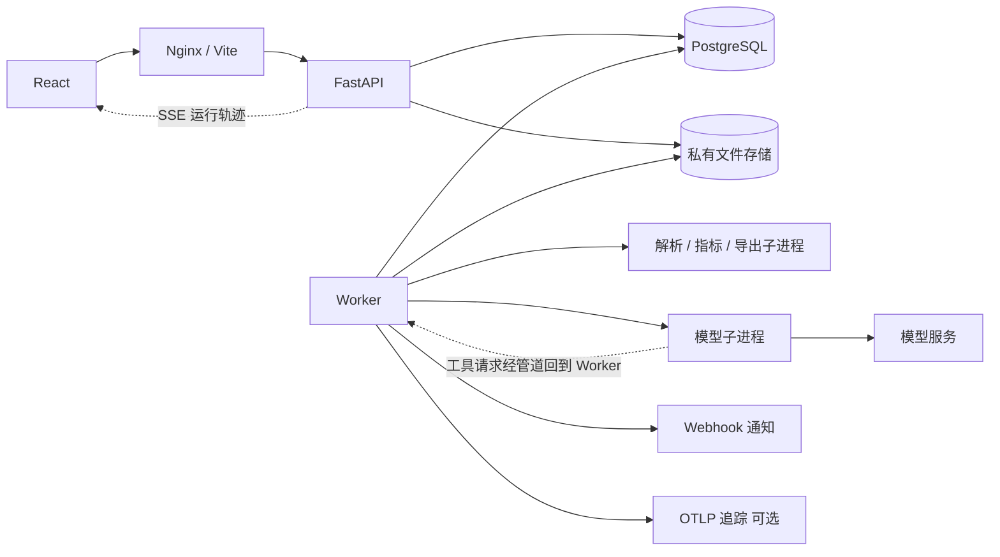

# ShopPulse 技术文档

本文描述 ShopPulse 当前源码的实现，面向开发、部署和维护。安装入口与功能演示见 [README](../README.md)。

[技术栈](#技术栈) · [架构与目录](#架构与目录) · [数据与任务](#数据与任务) · [导入与指标口径](#导入与指标口径) · [Agent 与模型边界](#agent-与模型边界) · [建议跟踪、商家备注与定时周报](#建议跟踪商家备注与定时周报) · [导出](#导出) · [API 与前端](#api-与前端) · [本地开发](#本地开发) · [运维与排障](#运维与排障) · [示例数据与复现](#示例数据与复现)

当前交付为桌面 Web、单店铺默认工作空间，窗口宽度至少 1024px。没有内建账号体系，没有 Windows 一键安装包；数据库必须是 PostgreSQL，不能替换为 SQLite。

实现基准：数据库迁移 `0002_agent_v2`、指标引擎 `2.0.0`、指标定义 `1.0`、异常规则 `1.0`、提示词 `2.0`、证据语法 `2.0`、授权范围 `2.0`。依赖版本以 `backend/uv.lock` 和 `frontend/package-lock.json` 为准。

## 技术栈

下表为当前实际使用的全部技术，版本取自锁文件与镜像标签。

| 层 | 技术 | 用途 |
| --- | --- | --- |
| 运行时 | Python 3.12（镜像 `python:3.12.12-slim`）、uv 0.12.23 | 后端运行时与依赖管理 |
| Web 框架 | FastAPI 0.142、Starlette、uvicorn 0.54、python-multipart | HTTP API、上传、Server-Sent Events |
| 数据校验 | Pydantic 2.13、pydantic-settings 2.15 | 请求/配置模型、模型输出 schema、`extra="forbid"` 严格校验 |
| 数据库 | PostgreSQL 17（`postgres:17.7-alpine`）、SQLAlchemy 2.0、psycopg 3.3、Alembic 1.20 | ORM、迁移、行锁与咨询锁、持久队列 |
| 计算 | Pandas 3.0、NumPy、Python `decimal` | Pandas 只做分组筛选，金额全程为整数最小货币单位与 Decimal |
| 文件解析 | openpyxl 3.1、defusedxml、标准库 `csv`/`zipfile` | 流式读取 XLSX/CSV，拒绝宏、公式、外部链接 |
| 进程隔离 | 标准库 `subprocess`、匿名管道上的逐行 JSON、psutil 7.2 | 解析、指标、导出、模型调用各自在子进程中运行并受内存/超时监控 |
| 凭证 | cryptography 50（AES-256-GCM、HKDF-SHA256） | API Key 与 Webhook 地址加密、密钥版本轮换 |
| 出站网络 | 标准库 `http.client`、`ssl`、`socket`、`ipaddress` | 自实现的加固 HTTP 客户端：DNS 校验、固定 IP 连接、拒绝重定向与代理；不使用厂商 SDK |
| 模型协议 | OpenAI Chat Completions、OpenAI Responses、Anthropic Messages | 三种接口的请求构建与响应解析，支持原生工具调用与 JSON Schema 结构化输出 |
| 通知 | 通用 JSON Webhook、Slack、飞书、企业微信、钉钉文本消息 | 定时周报完成后推送 |
| 导出 | fontTools 4.66（字体子集化）、Playwright 1.63 + Chromium（PDF 打印） | 离线 HTML、Markdown ZIP、A4 PDF |
| 可观测性 | OpenTelemetry SDK 1.45、OTLP/HTTP exporter | 可选链路追踪；本地运行记录与 trace ID 始终保留 |
| 前端 | React 19.3、TypeScript 5.9、Vite 7.3、react-router-dom 7.18、TanStack Query 5.104、lucide-react、原生 `EventSource` | 单页应用、轮询与 SSE、自绘 SVG 图表 |
| 前端测试 | Vitest 5、Playwright Test 1.63 | 单元测试与 Compose 端到端测试 |
| 后端测试 | pytest 9、pytest-cov、httpx、pypdf、ruff 0.16 | 真实 PostgreSQL schema 上的回归测试、覆盖率门槛、静态检查 |
| 部署 | Docker Compose v2、`nginxinc/nginx-unprivileged:1.28-alpine`、`node:24.14.0-alpine`（构建） | 五个服务：db、migrate、api、worker、web |
| CI | GitHub Actions、pip-audit、npm audit | 后端、前端、Compose 浏览器测试、离线 Agent 评测门禁 |

## 架构与目录

React 单页应用通过 Nginx（生产）或 Vite（开发）访问 FastAPI。API 只做短事务并创建任务；单个 Worker 用 PostgreSQL 表做持久队列，在子进程里完成解析、指标、导出和模型调用，没有 Redis / Celery。前端以 TanStack Query 轮询任务状态，报告运行轨迹另用 SSE 实时推送。



| 目录 | 内容 |
| --- | --- |
| `backend/app/api`、`core`、`db` | HTTP 路由、配置、日志、上传限制、ORM 模型 |
| `backend/app/ingestion`、`metrics` | 解析、校验、发布、指标引擎与快照缓存 |
| `backend/app/providers` | 模型协议适配、加固出站、凭证加密、连接测试、模拟模型服务 |
| `backend/app/reports` | 报告创建、工具与证据、证据语法、多步循环、追问、建议跟踪、提示词版本目录 |
| `backend/app/automation` | 定时周报调度、Webhook 推送 |
| `backend/app/jobs`、`exports`、`ops` | 队列与 Worker、导出渲染、运行管理与清理 |
| `backend/app/observability` | OpenTelemetry 初始化、调试留存清理 |
| `backend/app/evals`、`backend/evals` | 离线/在线评测流水线、合成用例与基线 |
| `backend/migrations`、`tests` | Alembic 迁移、回归测试 |
| `frontend/src/features`、`lib` | 功能页面、API 封装、中英文消息 |
| `samples`、`scripts`、`docs` | 示例数据、维护脚本、文档与截图 |
| `licenses`、`deploy`、`compose*.yaml` | 第三方许可、Nginx 配置、部署定义 |

## 数据与任务

### 数据模型

业务记录按服务端确定的 `workspace_id` 限定范围。表定义见 [models.py](../backend/app/db/models.py)，共 22 张业务表：

| 表 | 用途与约束 |
| --- | --- |
| `workspaces` | 默认店铺、币种、时区、保留策略及修订号 |
| `uploads` | 源文件哈希、解析状态、私有存储引用 |
| `imports` / `validation_issues` | 字段配置、用户处理决定、源行号与规则码 |
| `cost_versions` / `cost_rows` | 成本版本与 SKU 有效区间；工作空间内 fingerprint 唯一 |
| `dataset_versions` / `order_lines` | 订单版本与标准明细；版本内 line_id 唯一，按版本/时间、版本/SKU 建索引 |
| `metric_snapshots` / `metric_products` | 指标查询缓存与商品分页；工作空间内 cache_key 唯一，快照内 group_key 唯一 |
| `model_configs` | 协议、加密凭证、授权范围、能力测试结果；每个工作空间最多一个默认配置 |
| `reports` | 报告修订：查询、规则、输出语言、来源定时任务、冻结的模型快照与内容；series_id/revision 唯一 |
| `agent_runs` | 每次执行的预算、步骤、用量、trace ID、可选调试留存；job_id/attempt 唯一 |
| `tool_results` | 冻结的工具证据；按 report_id/tool/args_hash 建索引供复用 |
| `report_messages` | 追问与回答；报告内 sequence 唯一 |
| `action_items` | 由建议生成的行动项：状态、备注、最近一次效果评估；报告内 position 唯一 |
| `merchant_notes` | 商家备注：日期区间、类型、文本 |
| `report_schedules` | 定时周报：周期、执行日与时刻、模型、语言、加密的通知地址、上次与下次执行 |
| `jobs` / `worker_pulses` | 队列、幂等键、租约、心跳；按 status/available_at 索引领取 |
| `exports` / `audit_events` | 导出文件状态与有效期、操作审计摘要 |

发布冻结字段映射、口径和成本；报告冻结查询、规则、证据、模型配置与授权范围。新文件不会改写旧报告，新修订保留系列 ID 并递增 revision。导入草稿、模型配置、店铺设置、行动项和定时任务都用 `expected_revision`/`revision` 防覆盖；相同输入指纹复用数据版本。迁移 `0001_initial` 创建最初 19 张表，`0002_agent_v2` 增加行动项、备注、定时任务三张表以及协议、语言、trace 等列；后续结构变更追加新迁移。

```text
导入：mapping_required → validating → review_required / ready → publishing → published
报告：queued → computing → analyzing → ready / ready_with_warnings / failed
追问：queued → running → ready / ready_with_warnings / failed
作业：queued → running → succeeded / failed / cancelled
```

### 队列与 Worker

任务类型：`parse_upload`、`validate_import`、`publish_dataset`、`build_metrics`、`test_model`、`build_report`、`report_question`、`export_report`、`notify_webhook`。API 在短事务中创建任务；Worker 通过 `SELECT … FOR UPDATE SKIP LOCKED` 领取，独立线程心跳续租，提交结果时校验租约和 fencing token，拒绝过期进程写入。默认租约 90 秒、心跳 15 秒、最多领取 3 次。重试沿用任务 ID，不清零尝试次数；配置或资源已变化时拒绝过期重试。取消会终止受控子进程，已发出的模型请求仍可能计费；无法确认已消费预算时不重放外部请求（`MODEL_RETRY_SUPPRESSED`）。

Worker 主循环除了领取任务，每 30 秒检查到期的定时周报，每 10 分钟清理过期的调试留存。`SCHEDULER_ENABLED=false` 可关闭调度。

发布事务同时提交标准化明细、数据版本、草稿状态和任务结果。订单中的成本快照来自发布时匹配的成本版本，后续成本更新不追溯改写。数据版本不是源文件副本：按保留策略删除原文件后，标准化数据和已冻结的报告仍然保留。

## 导入与指标口径

支持普通 XLSX、UTF-8/BOM 或 GB18030 CSV，不支持 XLS、宏、加密工作簿。标题行 1–100；默认文件 20 MiB、10 万行、100 列、单元格 4096 字符。XLSX 最多 50 表、1000 ZIP 条目、解压合计 200 MiB；解析预算 120 秒 / 768 MiB。

字段与配置定义见 [ingestion/schema.py](../backend/app/ingestion/schema.py)，规则实现见 [normalize.py](../backend/app/ingestion/normalize.py)。

| 字段组 | 标准字段 | 说明 |
| --- | --- | --- |
| 标识 | `order_id`、`order_line_id`、`sku` | 按文本处理，保留前导零；Excel 已损失精度的长编号需回源修正 |
| 时间与数量 | `paid_at`、`quantity`、`restocked_quantity` | 支付归期、购买件数、已回库件数 |
| 实付与退款 | `line_paid_minor`、`line_refund_minor` | 源文件可用元或分，按选定单位转换；标准字段名不决定源列单位 |
| 分摊/派生 | `allocation_weight`、`shipping_minor`、`unit_price`、`discount_minor` | 订单级金额分摊、剔除运费、单价和优惠派生 |
| 状态与展示 | `payment_state`、`currency`、`product_name` | 支付状态映射、币种一致性、展示名称 |
| 成本 | `sku`、`unit_cost`、`currency`、`effective_from`、`effective_to` | 单位成本为主货币单位，同 SKU 成本区间不能重叠 |

`columns` 为“标准字段 → 源列名”，同一源列不可重复映射。别名识别只提供建议，仍需确认以下口径：

| 配置 | 可选值 / 约束 |
| --- | --- |
| `input_money_unit` / `currency_exponent` | `major` 或 `minor`；币种小数位 0–4 |
| `amount_scope` | 明细商品实付、订单商品实付、含运费订单实付、单价派生 |
| `payment_state_mode` | `mapped` 或 `confirmed_all_paid`；状态映射到 paid/unpaid/cancelled_unpaid |
| `refund_mode` / `refund_scope` | `provided`、`unknown`、`confirmed_none`；明细或订单级 |
| `coverage_start` / `coverage_end_exclusive` | 声明完整覆盖的时间区间，不由第一条/最后一条交易推断 |
| `source_as_of` | 退款数据截止时点，独立于支付周期 |
| `cost_effective_from/to` | 无成本时间列时填写静态成本适用范围 |
| `semantics_confirmed` / `coverage_confirmed` | 显式确认统计口径与覆盖范围 |

解析预览最多 10 行，未识别列的内容不回显。质量问题记录源行号；行号 0 表示文件或配置问题。文件位于私有存储，业务 API 不提供服务器物理路径或原文件公开链接。

冲突明细、超额退款、非法数量、混币种、关键字段公式和成本区间重叠阻断发布。重复、缺成本、未知退款等需确认，不静默去重、不计算公式、不把未知值补零。排除行及警告确认须记录原因，重新映射后旧决策失效。

订单级金额按优惠前金额权重使用最大余数法分摊，保持总额守恒；含运费时先扣除明确的运费。退款分摊至商品时标为估算。

| 指标 | 计算规则 |
| --- | --- |
| 商品实付 / 累计退款 | 实付合计 / 本期支付订单截至数据截止时间的退款 |
| 净销售额 | 商品实付 − 累计退款 |
| 支付订单量 / 件数 | 去重订单数 / 购买件数，包含后续全额退款订单 |
| 净客单价 | 净销售额 ÷ 支付订单量 |
| 净商品成本 | 每行成本 ×（购买数 − 已知回库数），转最小货币单位后四舍五入，再求和 |
| 商品毛利 / 毛利率 | 毛利 = 净销售额 − 成本；毛利率 = 毛利 ÷ 正的净销售额 |
| 退款金额占比 | 累计退款 ÷ 商品实付 |
| 成本覆盖率 | 匹配成本的行数占比、实付金额占比 |

毛利未扣佣金、广告、运费、人工和税费；累计退款归原支付周期，不是期间现金退款；各 SKU 的订单数不可直接相加。缺成本时整体毛利不可用，回库未知时成本不回转并标为估算；退款未知时净销售与毛利不可用。分母为零不返回 Infinity，覆盖不足时禁用完整周期比较。

API 数值用十进制字符串传输，例如 `{"value":"55000","unit":"minor_currency","quality":"confirmed","unavailable_reason":null}` 表示 CNY 550 元。质量为 `confirmed`、`estimated` 或 `unavailable`；不可用值为 null 并给出原因。

查询采用 `[start, end_exclusive)`，页面结束日包含当天；按数据版本时区划分自然日和周一，范围 1–366 天、最多 100 个 SKU。指标缓存键包含数据/成本版本、口径、查询和引擎版本；计算预算 120 秒 / 1536 MiB。算法或口径变化须更新对应版本，商品分页不改变总体指标。

比较方式为 `previous`、`custom`、`none`：previous 自动计算上一等长周期，custom 必须同时指定比较起止日期。SKU 排序去重后参与缓存键。完整覆盖且没有交易时金额和订单为零；没有记录且覆盖未知时不能解释为零销售。比率采用 Decimal，比较先计算后格式化；上期为零或负基期时提供差额和不可计算增长率的原因。销售贡献是描述性分解，不构成广告或促销效果的因果结论。

## Agent 与模型边界

核心原则：**数字由代码计算，模型负责解释**。所有数值、商品、日期、规则名只能通过“证据绑定”进入正文，由服务端取值渲染；每次工具调用都留下带哈希的证据；请求、工具、轮次、字节、token 和时间都有预算。

### 工具

服务端先运行七个核心工具并保存证据（不计入模型的工具预算），随后模型在受限循环中按需调用：

| 工具 | 参数 | 输出 |
| --- | --- | --- |
| `get_data_quality` | 无 | 覆盖、警告、排除行摘要 |
| `calculate_metrics` | 无 | 本期与比较期指标 |
| `get_sales_trend` | 可选报告期内子区间、指标子集（≤6） | 日趋势 |
| `rank_products` | 指标、方向、数量（1–50） | 商品排名 |
| `compare_periods` | 可选指标子集 | 差额、增长率及不可比较原因 |
| `decompose_sales_change` | 无 | 商品、订单量与客单价的描述性贡献 |
| `detect_anomalies` | 无 | 规则、阈值、触发项和限制 |
| `inspect_sku` | SKU | 单个商品两期指标、比较和日趋势（下钻） |
| `refund_breakdown` | 按 SKU 或按日，数量（1–10） | 退款最多的商品或日期 |
| `cost_coverage` | 数量（1–10） | 缺少成本的商品及其销售额 |
| `explain_metric` | 指标名 | 服务端维护的指标口径说明，不含数值 |
| `check_recommendation` | 无 | 到期复查的历史建议及其验证指标在提出时与本期的数值 |
| `get_merchant_notes` | 无 | 与本期或比较期重叠的商家备注 |

存在到期的历史建议或重叠的商家备注时，`check_recommendation` 与 `get_merchant_notes` 也由服务端预先运行。`inspect_sku` 由 Worker 进程用指标引擎对冻结数据版本中该 SKU 的订单明细重算，单次最多读取 `DRILL_ROW_LIMIT` 行，超出返回 `ROWS_LIMIT`；SKU 必须在报告范围内。其余工具只读报告上下文。同一报告内相同工具与相同参数（按参数哈希）复用已有证据，不重算也不重复记录；追问复用报告运行时产生的证据。工具没有任意代码、SQL、文件或网络执行权限。

证据记录 ID、报告、数据版本、查询范围、工具版本、参数及其哈希、结果及其哈希。哈希用于一致性检查，不是数字签名。

### 异常规则

默认规则：销售变化 ≥20%、退款占比 ≥10%、毛利率下降 ≥5 个百分点、确认的负毛利商品、前三 SKU 集中度 ≥70%、前置 28 个完整日的 MAD 离群值 ≥3.5。规则分别检查样本、覆盖、成本等前提，缺依据时显示不足；常规最低样本为 20 单，集中度至少 5 个活跃 SKU。MAD 不扩大查询范围，历史不足、MAD 为零或周粒度时不计算。阈值随报告冻结，规则限制说明按报告语言输出。

### 预算

每次报告或追问的模型阶段最多 **8 次工具、5 轮工具、每轮 3 个并行调用、8 次模型请求、2 次修复**；累计输入/输出 **480000/64000 UTF-8 字节**（每轮请求都重发整段对话，输入字节按累计计算），供应商返回 usage 时另限输入/输出 **120000/80000 token**；单次请求的输出上限参数为 4000（Anthropic 未配置长度参数时为 8000）。输出字节只统计回复正文和工具调用，不含 `reasoning_content` 等提供方附加字段；token 用量按提供方返回值统计，推理模型的推理 token 通常包含在内。模型子进程内部截止约 585 秒，父进程约 595 秒；600 秒预算不含排队和独立指标计算。连接测试最多 8 次合成请求、约 100 秒预算、110 秒子进程截止。

### 提示词与能力策略

提示词按版本存放在 [app/reports/prompts](../backend/app/reports/prompts)（公共规则、报告、追问三个文件）。修改提示词需新建版本目录并提升 `PROMPT_VERSION`，报告快照记录所用版本。

连接测试依次探测基础响应、工具调用及回传、JSON 模式（Anthropic 跳过）、JSON Schema 结构化输出，以及文本 JSON 兜底；能力策略依次为 `native_tools`（原生工具调用）、`restricted_json`（模型用 `{"tools":[...]}` JSON 信封请求工具）、`narrative`（不开放工具）。最终输出优先使用 JSON Schema 严格模式，其次 JSON 模式；工具与输出约束组合被拒绝（`UNSUPPORTED_REQUEST`）时去掉输出约束重试一次。单次 socket 超时 5–300 秒，默认 45 秒；服务是非流式的，带推理（thinking）的模型生成最终 JSON 常需两三分钟，须把超时调到足够大；响应上限 1 MiB；仅限流和服务异常允许一次短暂重试。探测通过不代表实际报告一定通过。

模型输出结构见 [reports/schema.py](../backend/app/reports/schema.py)：

| 输出 | 必要内容 |
| --- | --- |
| `summary[]` | 一到四个带绑定的句子 |
| `findings[]` | ID、topic（sales/refund/cost/product/period/quality/followup）、标题、observation、最多三条 supporting、最多三条 hypotheses；一到五条 |
| `recommendations[]` | action 句子、关联观察 ID、priority、effort、验证指标、复查周期；一到四条 |

### 证据语法

模型写带 `{{占位符}}` 的句子模板，每个占位符绑定一条证据和一个白名单路径；服务端解析路径、检查类型与格式一致后渲染。实现见 [grammar.py](../backend/app/reports/grammar.py)。

```json
{"template": "净销售额最高的商品是 {{sku}}，净销售额为 {{sales}}。",
 "bindings": [
   {"name": "sku", "evidence_id": "<id>", "path": "items.0.sku", "format": "entity"},
   {"name": "sales", "evidence_id": "<id>", "path": "items.0.current.metrics.net_sales", "format": "money"}]}
```

| format | 可绑定的值 | 渲染示例 |
| --- | --- | --- |
| `money` / `count` / `percent` | 按单位区分的指标、金额字段、比率与增长率 | `CNY 550.00`、`111`、`+10.00%`，估算值追加“（估算）” |
| `pp` | 比率的百分点变化 | `+1.82 个百分点` |
| `entity` | SKU；授权包含商品名时也可绑定商品名 | `A` |
| `date` | 趋势点与离群日期 | `2026-10-01` |
| `label` | 规则代码、规则状态、质量警告、指标名、复查结论、备注类型 | `负毛利商品`、`已触发`、`已改善` |
| `note` | 商家备注原文、历史建议原文（截断到 120 字并加引号） | `“国庆满减活动”` |

校验依次检查：占位符与绑定一一对应（每句最多四个绑定）；`evidence_id` 属于本报告且证据的报告、数据版本、查询范围、结果哈希一致；`path` 命中该工具的可绑定路径白名单（阈值、参数、哈希等无法进入正文）；路径能解析且值类型与 `format` 一致，不可用的指标不能绑定；去掉占位符后的模板、标题和其余自由文本不得出现数字（含中文和全角数字）、英文数字词、百分号、URL、`SKU` 字样或“保证、必然”等确定性断言，也不得直接写出证据里出现过的 SKU 或商品名；摘要、观察和 supporting 至少一个绑定，假设和建议可以不带绑定。

校验一次收集全部问题及其位置（如 `findings[0].supporting[1].bindings[0]: WRONG_FORMAT`），便于定向修复。模型看到的是核心证据的投影：保留证据 ID 和原始路径结构，去掉订单 ID、源行号和未授权的商品名；列表只截尾，所以截断后剩余路径仍然有效；规则检查与警告列表永不截断。模型完整回复和内部推理不会作为报告内容保存。

### 多步循环

实现见 [workflow.py](../backend/app/reports/workflow.py)。每一步都写入运行记录（`agent_runs.steps`），Worker 运行期间实时追加，报告页按步骤显示：

1. **规划**：服务端按意图给出 `analysis_goals`（销售变化、退款、毛利与成本、商品驱动等），附核心证据投影和可直接使用的事实句。
2. **调用工具**：模型一轮最多请求 3 个工具，超出的返回 `TOO_MANY_PARALLEL_CALLS`。未知工具、非法参数、超出预算都以错误结果回给模型。
3. **观察**：工具结果带证据 ID 返回；相同参数的重复调用返回 `DUPLICATE_CALL`，不产生新证据。
4. **收尾**：一轮没有新证据、达到 5 轮、请求或输入预算接近上限、剩余时间不足，任一情况即关闭工具（`tool_choice=none`）并要求最终 JSON。
5. **校验与修复**：最终输出未通过校验时，把问题位置和错误码发回模型，最多修复 2 次；服务端消息不回显模型原文。修复仍失败记 `EVIDENCE_VALIDATION_FAILED`，报告保留确定性结果。

对话超过 64 KB 时，早于当前轮的工具结果替换为“证据 ID 加前几项摘要”，完整结果仍在证据中。Anthropic Messages 例外：历史只追加、助手回合原样回放（含思考块），因为改写历史会使思考块失效，此时靠收尾条件控制长度。

模型循环运行在独立子进程中：子进程只持有 Key 并访问网络；所有工具通过匿名管道上的逐行 JSON 协议请求父进程（Worker）执行，因此下钻工具能读数据库而模型进程不能。子进程只回传原始输出，父进程用自己持有的证据重新校验，校验不通过记 `PARENT_VALIDATION_FAILED`。

### 追问

追问最长 2000 字符，每份报告同时一条。服务端先用规则拦截两类问题：需要广告、流量、库存数据的问题直接给出缺数据说明；明确涉及其他日期范围的问题，在未授权发送原问题时给出新建分析提示。其余问题交给模型，回答使用与报告相同的证据语法，可继续调用工具下钻。三种结果：

- `answer`：一到四句带绑定的回答，可附观察与建议。
- `clarify`：反问并给出最多三个选项，前端点选即填入问题框。
- `suggested_query`：给出建议的日期与 SKU 范围并说明理由，前端生成预填好的新建分析链接，原报告保持不变。

模型降级或未配置模型时返回 `fallback`：按问题主题（销售、退款、成本、商品）渲染原报告的可核验事实句。历史报告发现模型配置 revision 改变时同样降级。

### 授权范围

模型配置的授权记录（`consent`）版本为 `2.0`，字段为汇总指标、质量摘要、SKU、追问原文、商家备注，启用商品名模式时再加商品名。授权后原问题和最近三轮问答（服务端渲染后的回答文本）作为数据发送。按旧版本确认的配置 `consent_current` 为 false：模型页显示“确认新的授权范围”（`POST /model-configs/{id}/consent`），确认只更新授权记录，不改服务地址、密钥、能力测试结果和 revision。每份报告使用创建时冻结的授权：旧授权下的报告追问只发送问题主题，报告页和新建报告表单会提示。

### 模型协议

| 协议 | 请求路径 | 认证与版本 | 结构化输出 |
| --- | --- | --- | --- |
| `openai_chat` | `{根地址}/chat/completions` | `Authorization: Bearer` | `response_format` 的 `json_schema`（strict）或 `json_object` |
| `openai_responses` | `{根地址}/responses`，`store: false` | `Authorization: Bearer` | `text.format` 的 `json_schema`（strict）或 `json_object` |
| `anthropic_messages` | `{根地址}/messages` | `x-api-key`，`anthropic-version: 2026-10-21` | `output_config.format` 的 `json_schema` |

实现见 [protocols.py](../backend/app/providers/protocols.py)。循环内部使用统一的消息格式，按协议转换请求与解析响应；拒答记为 `MODEL_REFUSED`。三种协议都经同一个加固出站层直接发 HTTP 请求，没有引入厂商 SDK。Anthropic 当前模型不接受强制指定工具，连接测试改为提示调用；收尾时用 `tool_choice: none` 关闭工具；输入 token 统计包含缓存读写。不设置温度等采样参数。

### 输出语言

创建报告时可选中文或英文，默认取界面语言。语言决定提示词要求的书写语言、服务端渲染的标签（规则、状态、警告、指标名、复查结论、备注类型）、百分点单位、估算标记、事实句、固定限制说明和异常规则的限制说明。导出同样按报告语言输出章节标题、表头、单位、图表文字和 `lang` 属性；商品名、商家备注和报告标题保持原文。

### 凭证与出站

API Key 使用 AES-256-GCM、HKDF-SHA256 和 secret 主密钥保护，关联数据绑定工作空间、配置 ID 和密钥版本，经 stdin 传入模型子进程，不回显、不写日志。模型默认仅允许公网 HTTPS 443：逐次校验 DNS 结果、固定 IP 连接、验证 TLS、拒绝私网/保留/过渡网段、拒绝重定向和环境代理；精确内网来源通过 `MODEL_ALLOWED_ORIGINS` 授权。日志不记录请求正文、凭证或供应商完整回复；422 错误不序列化 Pydantic 细节，避免泄漏提交的 Key。

## 建议跟踪、商家备注与定时周报

**行动项。** 报告完成后，每条建议（含无模型时的固定建议）生成一个行动项，带验证指标和复查周期。商家可在报告页或“自动化”页把它标为待处理、已完成或已忽略并写备注；修改使用 revision 防覆盖。删除报告时连带删除。

**效果复查。** 新报告生成时，服务端找出同一店铺中未忽略、来源报告周期在本期开始之前结束的历史行动项（`next_month` 的建议还需相隔至少 28 天，最多 10 条），比较其验证指标在提出时与本期的数值：退款占比越低越好，其余越高越好；SKU 范围、币种不同或数值不可用时为“数据不足”。结论为“已改善”“未改善”或“数据不足”，写入报告的“上期建议跟进”、`check_recommendation` 证据和行动项的最近评估。这是描述性对比，不能证明建议导致了变化。

**商家备注。** 记录促销、节假日、缺货、调价、其他五类背景，区间 1–366 天、文本最长 300 字。与本期或比较期重叠的备注（最多 20 条）进入报告与 `get_merchant_notes` 证据，模型可以用 `note` 格式绑定原文写进假设。

**定时周报。** 每个任务指定数据版本（或始终使用最新版本）、模型、分析天数（1–31）、执行日与时刻（按店铺时区）、输出语言和异常规则，每个工作空间最多 20 个。Worker 每 30 秒检查到期任务：以数据覆盖截止日为终点取最近若干天，与上一等长周期比较；与上次报告的数据版本和结束日相同（没有新数据）则跳过。同一任务的报告是同一系列的连续修订；“立即运行”强制生成。行锁与幂等键保证多个 Worker 不会重复生成；数据版本被删除时任务自动停用，被引用的模型配置不能删除。

**通知推送。** 报告完成后，若任务配置了通知地址，Worker 执行 `notify_webhook` 任务，按所选格式（通用 JSON、Slack、飞书、企业微信、钉钉）推送标题、周期、前四句摘要和报告链接。地址用与模型 Key 相同的主密钥加密保存、不回显，密钥轮换时一并轮换；投递走同一出站策略，只允许公网 HTTPS，内网机器人地址需加入 `MODEL_ALLOWED_ORIGINS`；10 秒超时，响应正文不保存，失败不自动重试（可在运行管理重试任务）。

## 导出

导出共用冻结报告，不重新调用模型，在受监控的子进程中渲染。HTML 为单文件离线页面：服务端模板、转义数据、按正文子集化的 Noto Sans SC 字体和 SVG 图表以 data URI 内嵌，带禁止脚本与网络的 CSP。Markdown ZIP 包含 `report.md`、`evidence.json` 和两张 SVG。PDF 由 Playwright Chromium 以 A4 离线打印并阻断网络请求。章节包括经营概览、指标表、趋势与销售贡献、商品表现、异常与限制、经营观察与行动建议（含支撑事实与待验证假设）、上期建议跟进、商家备注、证据附录。默认保留 30 天，过期下载返回 410。

## API 与前端

接口前缀 `/api/v1`。成功返回 `{"data":...,"meta":{"request_id":"..."}}`，错误返回 `{"error":{"code":"...","message":"...","retryable":false},"meta":...}`；204、下载和 SSE 除外。写请求需准确 Origin；报告、追问、导出使用 8–128 字符 `Idempotency-Key`，同键不同参数返回 409。

| 资源 | 主要路径 |
| --- | --- |
| 健康、店铺、任务 | `/health/live`、`/health/ready`、`/workspace`、`/jobs`、`/jobs/{id}` |
| 上传与导入 | `/uploads`、`/imports`、`/imports/{id}`，子路径 `/mapping`、`/resolutions`、`/validate`、`/publish`、`/issues`；`/samples/{filename}` |
| 版本与指标 | `/datasets`、`/datasets/{id}`、`/datasets/{id}/skus`、`/cost-versions`、`/metrics/query`、`/metrics/{id}`、`/metrics/{id}/products` |
| 模型 | `/model-configs`、`/model-configs/{id}`、`/model-configs/{id}/test`、`/model-configs/{id}/consent`；配置含 `protocol` 与 `consent_current` |
| 报告 | `/reports`、`/reports/{id}`，子路径 `/runs`、`/runs/{run_id}/events`（SSE）、`/actions`、`/evidence/{evidence_id}`、`/messages`、`/exports` |
| 定时周报 | `/schedules`、`/schedules/{id}`、`/schedules/{id}/run` |
| 商家备注与行动项 | `/notes`、`/notes/{id}`、`/actions?status=open|done|dismissed|all`、`/actions/{id}` |
| 下载、运行管理 | `/exports/{id}/download`、`/operations/status`、`/operations/settings`、`/operations/audit` |
| 任务与清理 | `/operations/jobs/{id}/cancel`、`/retry`；`/operations/cleanup`、`/operations/deletion/{kind}/{id}` |

具体方法与字段见开发 API 的 [Swagger](http://127.0.0.1:8000/docs)。创建报告的 `model_config_id: null` 明确选择无模型；新修订需提供 `parent_id` 和完整查询；`language` 为 `zh` 或 `en`。

常用请求顺序：

1. `POST /uploads` 使用 multipart 提交 `kind=orders/costs` 和文件；轮询 `GET /uploads/{id}`。
2. `POST /imports` 创建草稿；`PUT /imports/{id}/mapping` 提交 `expected_revision` 和 config。
3. `POST /imports/{id}/validate` 发起校验；必要时 PUT resolutions，再校验。
4. `POST /imports/{id}/publish` 发布；轮询草稿直至 published，取得版本 ID。
5. `POST /metrics/query` 获取或触发指标快照；用返回的快照 ID 轮询指标和商品分页。
6. `POST /reports`、`POST /reports/{id}/messages`、`POST /reports/{id}/exports` 创建异步工作，分别轮询报告、消息或导出列表；运行中可订阅 `/reports/{id}/runs/{run_id}/events` 查看步骤。

创建报告示例（`POST /api/v1/reports`，另带 Origin 和唯一 Idempotency-Key）：

```json
{
  "title": "经营周报",
  "query": {
    "dataset_id": "替换为已发布订单版本的 UUID",
    "start": "2024-01-01",
    "end_exclusive": "2024-01-08",
    "comparison": "previous",
    "skus": [],
    "granularity": "day"
  },
  "model_config_id": null,
  "parent_id": null,
  "rules": {"min_orders": 20},
  "language": "zh"
}
```

追问请求为 `{"question":"这期退款需要关注什么？"}`，导出请求为 `{"format":"html"}`（也可 markdown/pdf）。SSE 流每秒检查一次步骤，发送 `event: step`，运行结束发送 `event: done`，每 10 秒发送注释心跳，600 秒后发送 `event: timeout`。清理或关联删除需先 GET 预览，再 POST `{"token":"预览返回值","confirmation":"确认删除"}`；关联或配置变化会使旧 token 失效。HTTP 202 只表示任务已提交，不能当作业务成功；最终以资源状态和错误码为准。

前端页面：工作台、数据中心、经营看板、智能周报、自动化、模型设置、运行管理。`lib/api.ts` 统一请求，URL 保留看板筛选；`lib/i18n.ts` 与消息字典管理中英文，localStorage 只保存 `shoppulse.language`，切换语言不重挂载页面、不丢表单、不翻译用户数据和历史报告。页面通过 TanStack Query 轮询，报告运行轨迹另用 `EventSource` 订阅 SSE，浏览器不支持或连接失败时退回轮询。React 负责格式化和绘图，不重新计算权威金额。新增状态或错误提示需同步中英文消息，避免在模块初始化时冻结翻译。

## 本地开发

需要 Python 3.12、uv、Node.js 24（最低 22.12）及 PostgreSQL 17。可使用 Docker 只启动开发数据库，也可完全原生运行。

以下命令默认 Windows PowerShell。先在根目录初始化配置，已有配置和密钥保留：

```powershell
if (-not (Test-Path .env)) { Copy-Item .env.example .env }
python scripts/init_secrets.py
```

使用 Docker 开发数据库时继续执行：

```powershell
docker compose -f compose.dev.yaml up -d --wait
Set-Location backend
uv sync --frozen
uv run playwright install chromium
uv run alembic upgrade head
Set-Location ../frontend
npm ci
```

Linux 安装 Chromium 用 `uv run playwright install --with-deps chromium`。开发数据库为 `127.0.0.1:5433`，与完整 Compose 数据库独立。

分别在三个终端启动：

```powershell
# backend 目录：API
uv run uvicorn app.main:app --host 127.0.0.1 --port 8000 --reload --no-access-log --no-proxy-headers
# backend 目录：Worker（另一终端）
uv run python -m app.jobs.worker
# frontend 目录：页面（另一终端）
npm run dev
```

访问 [http://localhost:5173](http://localhost:5173)，Vite 代理 `/api`。完整 Docker Web 不代理 Swagger。虚拟环境可能依赖 `.cache/python`，清理前检查 `backend/.venv/pyvenv.cfg`。

### 无 Docker 运行

1. 安装并启动本机 PostgreSQL 17，确认实际监听端口（一般为 5432）。Python、uv、Node.js 需在 PATH 可用。
2. 完成上述 `.env`、密钥初始化。通过数据库管理工具创建可登录角色 `shoppulse`，将其密码设为本机 `secrets/database_password` 的内容；创建由该角色拥有的 `shoppulse` 数据库。密码文件至少 32 字符，不在文档或命令行中硬编码真实密码。
3. 在 `.env` 设置以下内容；端口按实际安装修改：

```dotenv
DATABASE_HOST=127.0.0.1
DATABASE_PORT=5432
DATABASE_NAME=shoppulse
DATABASE_USER=shoppulse
DATABASE_PASSWORD_FILE=secrets/database_password
CREDENTIAL_MASTER_KEY_FILE=secrets/credential_master_key
APP_PUBLIC_URL=http://localhost:5173
STORAGE_ROOT=data
```

4. 在 backend 运行 `uv sync --frozen`、`uv run playwright install chromium`、`uv run alembic upgrade head`；在 frontend 运行 `npm ci`。Linux 的 Chromium 安装使用 `--with-deps`。
5. 按前面的三个终端命令启动 API、Worker、前端，访问 `http://localhost:5173`。检查 `http://127.0.0.1:8000/api/v1/health/ready`，并在运行管理确认 Worker 在线。

此方案是原生开发运行方式，停止用各终端的 Ctrl+C；尚无自动安装器或 Windows 服务管理。不要将已有 Docker 数据卷理解为本机 PostgreSQL 的数据，两套实例独立。`scripts/backup.py` 仅服务于 Compose 实例；原生部署需在停止应用写入后配套备份数据库、STORAGE_ROOT 和密钥。

### 模拟模型与测试

```powershell
# 项目根目录；使用独立测试实例，浏览器测试会写入样例数据
docker compose -f compose.yaml -f compose.mock.yaml up -d --build
```

模型页填 `http://mock-provider:8099/v1`，Key 留空，模型名 `full`；模拟服务同时提供 `/v1/chat/completions`、`/v1/responses` 和 `/v1/messages`，可选择任一协议。模型名决定行为：`agent` 演示多步下钻（退款拆解、商品排行、SKU 下钻和一次被拒绝的重复调用），`clarify` 与 `suggest` 演示追问的反问与建议范围，`no-tools` / `text-json`、`narrative` 演示降级策略，`auth-fail`、`missing`、`rate-limit`、`unavailable`、`redirect`、`invalid`、`bad-number`、`foreign-evidence`、`unsafe-tool`、`malformed-report`、`repair-once` 演示各类故障。

原生模拟需设置 `MODEL_ALLOWED_ORIGINS=["http://127.0.0.1:8099"]` 并重启 API/Worker，在 backend 运行 `uv run python -m app.providers.mock_server`，模型根地址改为 `http://127.0.0.1:8099/v1`。

```powershell
# backend 目录；先启动开发数据库
uv run ruff check .
uv run ruff format --check .
uv run alembic check
uv run pytest -q --cov=app.metrics --cov=app.ingestion.normalize --cov-branch --cov-report=json:coverage.json
uv run python ../scripts/check_coverage.py coverage.json
uv run python -m app.evals run --gate

# frontend 目录
npm test
npm run build
npx playwright install chromium
$env:E2E_BASE_URL = 'http://localhost:8080'
$env:E2E_MODEL_BASE_URL = 'http://mock-provider:8099/v1'
npm run test:e2e
```

后端共 237 个 pytest 用例，在随机 PostgreSQL schema 中执行真实迁移；指标与标准化模块的行/分支覆盖门槛均为 90%。主要回归范围：金额精度与分摊守恒、CSV/XLSX 等价、字段与资源边界、版本冻结、三种协议的真实 HTTP 与子进程管道、崩溃恢复与取消、出站策略、凭证加密与轮换、伪造证据、定时与推送、授权升级、英文导出、关联清理和离线导出。测试角色需要创建/删除 schema 权限，PDF 测试需要 Chromium。浏览器测试覆盖导入、看板、模型、报告、导出、运维和双语，关闭 trace 以避免采集配置表单里的凭证；不配置 `E2E_MODEL_BASE_URL` 时跳过模型流程。

### Agent 评测

评测代码在 [app/evals](../backend/app/evals)，用例在 [evals/cases.json](../backend/evals/cases.json)。十个用例各用固定随机种子生成合成订单并注入有标注的业务变化：平稳周、退款激增、销售下滑、负毛利、缺成本、销售集中、单日离群、促销期间的销售激增（附商家备注）、英文报告，以及一条退款追问。

```powershell
# backend 目录，无需数据库或模型服务
uv run python -m app.evals run --gate
# 真实模型：使用已测试可用的模型配置，可另配一个评审模型
uv run python -m app.evals run --suite live --model-config <id> --judge-config <id>
# 人工校准评审：导出、填写人工分后计算一致性
uv run python -m app.evals export-labels --run <run.json> --out labels.csv
uv run python -m app.evals calibrate --labels labels.csv
```

| 指标 | 含义 |
| --- | --- |
| `success` / `first_pass` | 通过证据校验的比例 / 无需修复即通过的比例 |
| `entity_coverage` | 用例要求点名的 SKU 出现在报告中的比例 |
| `rule_recall` | 规则引擎触发了用例设计要触发的规则（检验合成数据与规则口径一致） |
| `rule_mention` | 报告通过绑定提到了这些规则 |
| `tool_effectiveness` | 模型发起且成功的工具调用中，结果被最终报告引用的比例 |
| `forbidden_hits` | 报告出现禁止断言的次数 |
| `judge_*` | 评审分（1–5）：假设合理性、建议可执行性、具体程度 |

离线套件用脚本化的参考策略驱动真实的工具、循环和校验，不发起任何网络请求，评审使用标注为 `heuristic` 的启发式打分；`--protocol` 可选择线格式。CI 运行 `--gate`：任一门控指标比 [baseline.json](../backend/evals/baseline.json) 低 0.05 以上，或禁止断言增加，即失败。修改提示词、语法或工具后如指标有意变化，用 `--update-baseline` 更新基线并在提交中说明。离线套件衡量的是流水线；模型本身的效果要用 `--suite live` 对真实模型测，结果写入 `.cache/evals/`。真实评审只看到服务端渲染后的报告文本和用例描述，不接触凭证和原始订单；`calibrate` 计算评审与人工的平均绝对误差和 Spearman 相关。

### 追踪与调试留存

设置标准环境变量 `OTEL_EXPORTER_OTLP_ENDPOINT`（如自托管 Langfuse 或 Arize Phoenix 的 OTLP/HTTP 地址）后，Worker（`shoppulse-worker`）与模型子进程（`shoppulse-agent`）导出链路：`agent.run`（父进程）→ `agent.workflow`（子进程，经 `traceparent` 关联）→ 每次模型请求 `gen_ai.chat` 与每次工具调用 `tool.<名称>`。属性只含协议、模型名、字节数、token 数、调用序号、错误码等，不含提示词、数据或凭证。未配置时不导出，运行记录仍保存本地 trace ID 和带耗时的步骤。

`AGENT_DEBUG_CAPTURE=true` 时，每次模型请求与响应截断到 8 KB 保存在 `agent_runs.debug`（每次运行最多 16 条），用于排查输出不通过的原因；Key 不在请求正文中，不会被保存。Worker 每 10 分钟清除超过 `AGENT_DEBUG_RETENTION_DAYS` 的记录。该开关会留存发送给模型的数据，生产环境默认关闭。

### 交付检查与 CI

源码交付检查在根目录运行：

```powershell
backend/.venv/Scripts/python.exe scripts/check_versions.py
python scripts/test_release.py
python scripts/check_secrets.py --compose
backend/.venv/Scripts/python.exe scripts/dependency_inventory.py
python scripts/release.py
```

Linux/macOS 将解释器路径改为 `backend/.venv/bin/python`。打包按白名单排除密钥、运行数据、依赖和缓存，生成源码 ZIP、MANIFEST、SHA256SUMS；不自动发布 GitHub 或镜像。

CI 定义在 [.github/workflows/ci.yml](../.github/workflows/ci.yml)，包含三个 job：后端（版本一致性、发布边界与密钥检查、pip-audit、ruff、迁移检查、pytest 与覆盖率门槛、离线评测门禁）、前端（Vitest、构建、npm audit）、Compose 浏览器测试（带模拟模型的完整实例、冒烟测试、Playwright 端到端、容器内密钥扫描）。Release 工作流复用这些检查后生成源码包。增加数据库字段需新增 Alembic 迁移；变更金额算法、缓存语义、提示词、语法或规则时更新对应版本、独立期望值和评测基线。

## 运维与排障

### 配置

原生进程读取根目录 `.env`，环境变量优先；容器以 `compose.yaml` 的 environment 为准，额外参数需 Compose override。修改后重启 API/Worker。

| 配置 | 默认值 / 用途 |
| --- | --- |
| `APP_PUBLIC_URL` | 原生 `http://localhost:5173`，允许的写请求 Origin |
| `COMPOSE_PORT` / `COMPOSE_PUBLIC_URL` | `8080` / `http://localhost:8080`，须配套修改 |
| `DATABASE_HOST/PORT/NAME/USER` | 原生 `127.0.0.1:5433`、`shoppulse`；容器 `db:5432` |
| `DATABASE_PASSWORD_FILE` / `CREDENTIAL_MASTER_KEY_FILE` | 数据库密码 / 凭证主密钥文件（模型 Key 与 Webhook 地址共用） |
| `CREDENTIAL_KEY_VERSION` / `CREDENTIAL_OLD_KEYS` | 当前密钥版本 / 旧版本到文件路径映射 |
| `MODEL_ALLOWED_ORIGINS` | 精确来源白名单，模型服务与 Webhook 共用，默认空数组 |
| `STORAGE_ROOT` | 原生 `data`；容器 `/data/shoppulse` |
| `MAX_UPLOAD_MIB` / `MAX_IMPORT_ROWS` | `20` / `100000` |
| `JOB_LEASE_SECONDS` / `JOB_HEARTBEAT_SECONDS` | `90` / `15`，心跳小于租约一半 |
| `JOB_POLL_SECONDS` / `JOB_MAX_ATTEMPTS` | `2` / `3` |
| `APP_ENV` / `APP_TIMEZONE` | 原生 development / 初始店铺 Asia/Shanghai |
| `PARSE_TIMEOUT_SECONDS` / `LOG_LEVEL` | `120` / `INFO` |
| `PDF_CHROMIUM_PATH` | 可选，自定义 PDF Chromium 可执行文件位置 |
| `DRILL_ROW_LIMIT` | `20000`，单次 SKU 下钻最多读取的订单明细行（100–100000） |
| `AGENT_DEBUG_CAPTURE` / `AGENT_DEBUG_RETENTION_DAYS` | `false` / `7`，模型请求与响应调试留存 |
| `SCHEDULER_ENABLED` | `true`，关闭后 Worker 不执行定时周报 |
| `OTEL_EXPORTER_OTLP_ENDPOINT` | 可选，OpenTelemetry OTLP/HTTP 导出地址 |

Compose 按 db → migrate → api / worker / web 启动，migrate 以 0 退出正常。默认仅 Web 监听 `127.0.0.1:8080`，Nginx 反代 `/api/`（上传上限 21 MiB，SSE 依赖 API 的 `X-Accel-Buffering: no` 与心跳）；远程部署需 HTTPS 和部署层访问控制，Origin 校验不代替权限控制。第二实例需独立目录、密钥、project 名和端口。

配置实现见 [core/config.py](../backend/app/core/config.py)，容器参数见 [compose.yaml](../compose.yaml)。API readiness 同时检查数据库与迁移版本；API/Worker 采用非 root 用户、只读根文件系统和专用可写卷。相对 secret、存储路径相对于仓库根目录，不能依赖调用终端的当前目录。

### 清理、备份与升级

删除前先预览关联影响，再用预览 token 确认。删除成本会连带引用的订单版本；删除订单会连带指标、报告、证据、行动项和导出，并停用引用该版本的定时任务；只删除报告保留数据。存在活动任务时不执行破坏性清理。原文件默认不按天数清理，过期导出按保留天数清理。

```powershell
# 根目录；备份目录必须全新
python scripts/backup.py backup --directory backups/my-backup
python scripts/backup.py restore --directory backups/my-backup --project shoppulse-restore-drill
```

备份短暂停止 Web/API/Worker，保存数据库、存储和哈希后恢复服务；**不包含 secrets，也不加密压缩包**，密钥需独立保管。恢复仅允许全新 `shoppulse-restore-` 实例，不覆盖已有容器或卷；演练不发布端口，Worker 保持停止。恢复工具生成 `.cache/restore-image.json` 用于管理恢复实例，并检查备份哈希、归档路径和文件类型、数据摘要及凭证解密；跨机器恢复需要同版本镜像/源码和原密钥。

```powershell
docker compose -f compose.yaml -f .cache/restore-image.json -p shoppulse-restore-drill ps
docker compose -f compose.yaml -f .cache/restore-image.json -p shoppulse-restore-drill down
```

密钥轮换：备份后停 API/Worker，新增主密钥文件及版本，通过 `CREDENTIAL_OLD_KEYS` 保留旧文件；在 backend 执行 `uv run python -m app.cli rotate-credentials --dry-run`，确认后去掉 `--dry-run`。轮换同时覆盖模型 Key 和 Webhook 地址。Docker 需 override 挂载新旧 secret。勿覆盖旧密钥，旧备份仍可能需要它。

升级前备份并记录镜像/密钥版本，再执行 `docker compose up -d --build`，migrate 服务自动应用新迁移；回退使用匹配的旧镜像和备份，不让旧代码连接不兼容的新 schema。从旧版本升级后，模型页会提示旧授权的配置确认新的授权范围。

### 常见问题

| 问题 | 处理 |
| --- | --- |
| 页面打不开 | 检查 Docker 与 `docker compose ps`；日志用 `docker compose logs --tail 50 api worker` |
| 任务一直排队 | 运行管理检查 Worker 心跳；执行 `python scripts/smoke_test.py` |
| 无法发布数据 | 修正阻断、确认警告、保存最新字段及口径后重新校验 |
| CSV/XLSX 解析不对 | 检查编码、分隔符、工作表和标题行 |
| 模型连接通过但报告降级 | 查看错误码与运行记录，检查超时、预算和证据校验；计算结果仍保留 |
| 追问只给出摘要 | 配置仍是旧授权或报告创建于确认授权之前；确认授权后新建报告 |
| 定时周报没有生成 | 检查 `SCHEDULER_ENABLED`、Worker 在线、任务已启用且数据版本仍存在；没有新数据会跳过 |
| 通知未送达 | 任务记录的错误码；内网地址需加入 `MODEL_ALLOWED_ORIGINS`，公网地址须 HTTPS 443 |
| 请求来源不受信任 | 地址须与 public URL 完全一致，localhost 与 127.0.0.1 不等价 |
| 下载过期 | 重新生成导出 |
| 上传超限 | 同步调整 API、Nginx `client_max_body_size`（默认 21 MiB）及界面提示 |

| 模型错误码 | 排查方向 |
| --- | --- |
| `AUTH_FAILED` / `MODEL_NOT_FOUND` | Key、权限、模型 ID、API 根路径与协议是否匹配 |
| `EGRESS_BLOCKED` / `REDIRECT_BLOCKED` / `DNS_FAILED` / `TLS_FAILED` | 精确来源白名单、最终服务地址、证书 |
| `TIMEOUT` / `RATE_LIMITED` / `PROVIDER_UNAVAILABLE` | 服务响应时间、限流或配额 |
| `UNSUPPORTED_REQUEST` | 服务不支持工具、JSON 模式或 JSON Schema 的组合；连接测试会降级策略 |
| `MODEL_REFUSED` | 服务返回拒答 |
| `BUDGET_EXCEEDED` | 整次执行的请求、字节、token、工具或时间预算 |
| `EVIDENCE_VALIDATION_FAILED` / `MODEL_OUTPUT_INVALID` | 输出结构、绑定路径、格式或自由文本约束；运行记录列出具体位置 |
| `PARENT_VALIDATION_FAILED` | 子进程输出未通过父进程复核，视为不可信 |
| `INSUFFICIENT_EVIDENCE` | 本期没有可用指标事实，常见于覆盖不足或退款未知 |
| `CREDENTIAL_UNAVAILABLE` | secret 主密钥是否匹配保存时版本 |
| `MODEL_RETRY_SUPPRESSED` | 上次外部调用消费量不确定，系统避免重复调用 |
| `WEBHOOK_REJECTED` / `WEBHOOK_UNAVAILABLE` / `INVALID_WEBHOOK_URL` | 机器人地址返回非 2xx、地址未配置或格式不合规 |

排障使用请求 ID、公开错误码、报告运行记录和 trace ID，勿记录或粘贴 API Key、完整配置环境、模型内部推理。原文件、报告导出及备份的访问权限由部署者控制；密钥泄露后需在服务商处撤销并轮换。

## 许可

项目自有代码与文档采用 [MIT License](../LICENSE)，版权声明为 `Copyright (c) 2026 陈实当 CHEN SHIDANG (UrianChen)`。使用、修改和分发时遵守 LICENSE，保留版权和许可声明；软件按原样提供。

第三方组件、字体及外部演示数据不属于本项目 MIT 授权范围，仍按各自原始许可处理。完整组件声明见 [licenses](../licenses/)，字体许可见 [OFL.txt](../backend/assets/fonts/OFL.txt)。TheLook 镜像数据的再分发授权尚未核实，不能凭代码许可证推定可再分发。

源码包包含根目录 LICENSE、第三方声明和文档。生产镜像仅打包运行所需内容，测试、文档截图和 TheLook 演示数据不进入镜像；内置小样例仍可从数据中心下载。后端镜像保留 `/app/LICENSE` 与 `/app/licenses/`，前端镜像保留 `/usr/share/doc/shoppulse/LICENSE` 与 `licenses/`。语言依赖清单不替代容器系统组件的完整许可清单。

## 示例数据与复现

### 轻量样例

[成本 CSV](../samples/costs.csv)、[订单 CSV](../samples/orders.csv) 与 [订单 XLSX](../samples/orders.xlsx) 用于快速验证；订单含相同的 6 条明细，XLSX 工作表为“订单明细”。配置 `CNY`、`Asia/Shanghai`、元、明细商品实付、不含运费、全部已支付、已提供明细累计退款；覆盖 `[2026-09-21T00:00:00+08:00, 2026-10-05T00:00:00+08:00)`，截止 `2026-10-07T00:00:00+08:00`。

分析 2026-09-28 至 10-04，比较上一等长周期：

| 指标 | 本期 | 上期 |
| --- | ---: | ---: |
| 商品实付 / 累计退款 | 650 / 100 | 500 / 0 |
| 净销售额 | 550 | 500 |
| 支付订单量 / 净客单价 | 3 / 183.33 | 2 / 250 |
| 商品毛利 / 毛利率 | 230 / 41.82% | 200 / 40.00% |

金额单位 CNY。本期不足 20 单，部分规则显示样本不足属于预期结果。独立期望值保存在 [expected_metrics.json](../samples/expected_metrics.json)，用 `python scripts/generate_demo.py` 重建轻量样例。

### TheLook 来源

数据来自 [Google TheLook eCommerce](https://console.cloud.google.com/marketplace/product/bigquery-public-data/thelook-ecommerce)，这是虚构服装电商的合成数据。本次下载使用 [公开 CSV 镜像的固定版本](https://github.com/marcelFRO/ecommerce-analytics/tree/bb74707d5ab31c35795e017d2dc7f98895efb0af/data/raw)，没有下载客户或访问日志表。原始文件 SHA-256、转换假设和独立核算值记录在 [provenance.json](../samples/thelook/provenance.json)。镜像数据不自动适用本项目代码许可。

### 数据与口径

准备好的文件为 [商品成本](../samples/thelook/costs.csv) 和 [订单明细](../samples/thelook/orders.csv)。共 **9,812 笔订单、14,208 条明细、11,248 个 SKU**，覆盖 2023-11-13 至 2024-01-07。重新下载并转换同一份源数据，可运行 `python scripts/prepare_thelook.py`；脚本先验证源文件哈希，再检查唯一键、关联和订单明细完整性。

**演示口径不等于源数据中的真实支付流水：**

- 纳入 `Complete`、`Shipped`、`Returned`，假设这些订单已支付；不纳入 `Processing`、`Cancelled`。完整覆盖仅指这个筛选集合。
- 以订单创建时间代替支付时间；每条商品明细按一件计，SKU 映射为 `TL-商品 ID`。
- `Returned` 按全额退款演示，其他纳入状态按无退款演示。源数据没有实际退款金额，相关净值与退款占比均依赖这个假设。
- 回库数量保持未知，应用按不回转成本计算并标记毛利为**估算**；商品静态成本用于整个演示周期。
- 使用 UTC、USD；金额四舍五入到美分，单位成本保留六位小数。数据截止时间约定为 2024-01-28，晚于所选退货记录，不能当作官方数据抽取时间。

先导入成本文件，再导入订单文件并关联该成本版本。字段自动识别后，确认以下设置：

| 配置 | TheLook 演示值 |
| --- | --- |
| 时区 / 币种 / 小数位 | `UTC` / `USD` / `2` |
| 金额单位 / 层级 | 主货币单位 / 明细商品实付，不含运费 |
| 支付 / 退款口径 | 确认全部已支付 / 已提供累计商品退款 / 明细退款 |
| 覆盖开始 | `2023-11-13T00:00:00+00:00` |
| 覆盖结束（不含） | `2024-01-08T00:00:00+00:00` |
| 数据截止时间 | `2024-01-28T00:00:00+00:00` |

校验会提示 **2,245 条 `RESTOCK_UNKNOWN` 警告、0 条阻断**。核对上述演示假设，填写接受警告的原因，不排除任何行，再校验并发布。看板和周报选择 **2024-01-01 至 2024-01-07**，对比上一等长周期 **2023-12-25 至 2023-12-31**。

| 本周指标 | 实际计算结果 |
| --- | ---: |
| 退款前商品实付 | USD 140,141.09 |
| 累计退款（演示假设） | USD 23,780.74 |
| 净销售额 | USD 116,360.35 |
| 支付订单量 / 件数 | 1,607 / 2,377 |
| 净客单价 | USD 72.41 |
| 净商品成本（估算） | USD 67,450.26 |
| 商品毛利（估算） | USD 48,910.09 |

实际页面截图见 [README 的运行示例](../README.md#运行示例)。
